# Salesforce Customer Service Extension - Architecture Documentation

**Version**: 2.0.16
**Last Updated**: 2025-11-27
**Java Version**: 21
**Gradle Version**: 8.10
**Salesforce API Version**: v53.0+

---

## Table of Contents

1. [Architecture Overview](#1-architecture-overview)
2. [5-Layer Architecture](#2-5-layer-architecture)
3. [Component Architecture](#3-component-architecture)
4. [Data Flow Architecture](#4-data-flow-architecture)
5. [Authentication & Authorization](#5-authentication--authorization)
6. [Error Handling Architecture](#6-error-handling-architecture)
7. [Performance Characteristics](#7-performance-characteristics)
8. [Scalability and Limitations](#8-scalability-and-limitations)
9. [Security Architecture](#9-security-architecture)
10. [Deployment Architecture](#10-deployment-architecture)
11. [Summary](#11-summary)

---

## 1. Architecture Overview

### 1.1 Key Architectural Principles

The Salesforce Customer Service Extension follows these core principles:

- **Separation of Concerns**: Clear separation between catalog areas, service interfaces, and implementation
- **Dependency Injection**: JSR-330 (javax.inject) for loose coupling and testability
- **Interface-Based Design**: Service interfaces define contracts, implementations provide functionality
- **Validation Framework**: Orchestrated validation with pluggable validators
- **Error Handling**: Sophisticated error handling with state management and remediation actions
- **OAuth 2.0 Security**: Secure authentication with token management and refresh capabilities

### 1.2 Technology Stack

| Component | Technology | Version |
|-----------|-----------|---------|
| **Language** | Java | 21 |
| **Build Tool** | Gradle | 8.10 |
| **DI Framework** | HK2 (JSR-330) | - |
| **HTTP Client** | ScribeJava OAuth | 8.3.3 |
| **JSON Processing** | Jackson + Gson | 2.15.2 |
| **Logging** | SLF4J + Logback | 2.0.7 |
| **Salesforce API** | REST API | v53.0+ |
| **Krista SDK** | Extension SDK | 1.0.117 |

### 1.3 Design Philosophy

The extension is designed with the following goals:

1. **Modularity**: Each functional area is independent and can be extended
2. **Testability**: Interface-based design enables easy mocking and testing
3. **Maintainability**: Clear structure and comprehensive validation framework
4. **Reliability**: Robust error handling with user-friendly messages and remediation
5. **Security**: OAuth 2.0 with secure token storage and refresh mechanisms
6. **Performance**: Efficient API usage with proper resource management

---

## 2. 5-Layer Architecture

The extension follows a clean 5-layer architecture pattern:

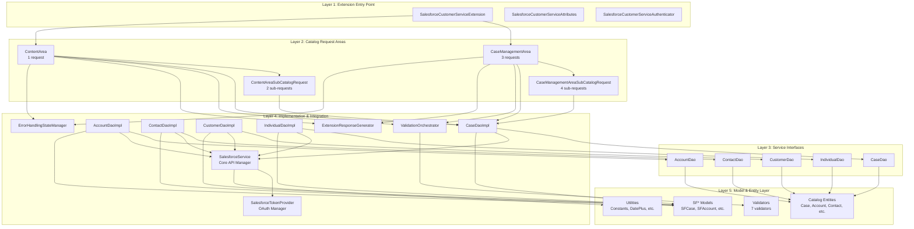

### 2.1 Layer 1: Extension Entry Point

**Purpose**: Extension lifecycle management, configuration, and initialization

#### Components:

1. **SalesforceCustomerServiceExtension**
   - Main extension class annotated with `@Extension`
   - Version: 2.0.16
   - Manages extension lifecycle (validation, test connection, attribute updates)
   - Registers request authenticator and custom tabs
   - Configuration attributes: CLIENT_ID, CLIENT_SECRET, INSTANCE_URL, USER_NAME, PASS_WORD, SECURITY_TOKEN, SANDBOX

2. **SalesforceCustomerServiceAttributes**
   - Holds Salesforce configuration attributes
   - Manages OAuth service initialization
   - Validates instance URL format
   - Provides attribute update mechanism

3. **SalesforceCustomerServiceAuthenticator**
   - Implements request authentication
   - Manages OAuth token lifecycle
   - Handles token refresh and expiration

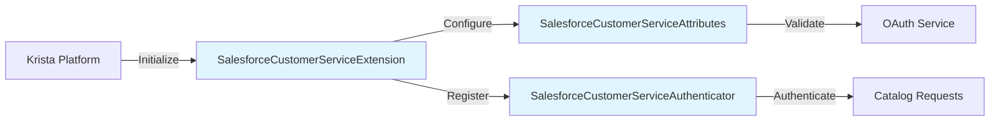

### 2.2 Layer 2: Catalog Request Areas

**Purpose**: Expose functional capabilities as catalog requests

#### Functional Areas:

| Area | Domain | Requests | Description |
|------|--------|----------|-------------|
| **CaseManagementArea** | Customer Relations (CRM) | 3 main + 4 sub | Case management operations |
| **ContentArea** | Customer Relations (CRM) | 1 main + 2 sub | Content and metadata operations |

#### CaseManagementArea Catalog Requests:

1. **Get Case Feed Items By Case Id** (QUERY_SYSTEM)
   - Fetches feed items for a given case
   - Parameters: Case Id (required), Number Of Posts (optional)
   - Returns: List of feed items with actor name, post message, and files

2. **Share Update to Case** (CHANGE_SYSTEM)
   - Posts an update to a case feed
   - Parameters: Case Id, Update Message, File (optional)
   - Validation: Case ID, message content, file format

3. **Case Change Alert** (WAIT_FOR_EVENT)
   - Monitors case changes and triggers alerts
   - Parameters: Case Id, Polling Interval
   - Event-driven architecture for real-time updates

#### CaseManagementAreaSubCatalogRequest (4 sub-requests):

1. **REENTER** - Re-enter validation data
2. **CONFIRM** - Confirm action
3. **FETCH** - Fetch additional data
4. **DENY** - Deny action

#### ContentArea Catalog Requests:

1. **Retrieve Custom Fields For Given Object** (QUERY_SYSTEM)
   - Retrieves custom field metadata for Salesforce objects
   - Parameters: Object Type (Account, Case, Contact, Customer, Individual)
   - Returns: List of custom fields with metadata

#### ContentAreaSubCatalogRequest (2 sub-requests):

1. **REENTER** - Re-enter object type
2. **FETCH** - Fetch custom fields

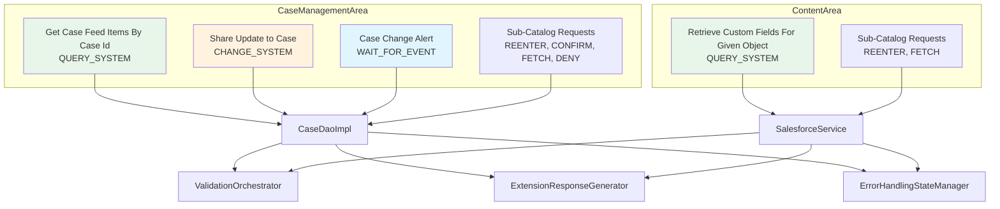

### 2.3 Layer 3: Service Interfaces

**Purpose**: Define contracts for data access operations

#### Service Interfaces (DAO Pattern):

All service interfaces follow the Repository Pattern with standard CRUD operations:

| Interface | Entity | Special Methods |
|-----------|--------|-----------------|
| **CaseDao** | Case | `getFeedItemsForCaseId()`, `addFeedUpdateToCaseById()` |
| **AccountDao** | Account | Standard CRUD |
| **ContactDao** | Contact | Standard CRUD |
| **CustomerDao** | Customer | Standard CRUD |
| **IndividualDao** | Individual | Standard CRUD |

#### Standard DAO Methods:

```java
// Common interface methods
T getById(String id) throws MustAuthorizeException;
List<T> getAll() throws MustAuthorizeException;
List<T> getByQuery(String query) throws MustAuthorizeException;
String create(T entity) throws MustAuthorizeException;
void update(T entity) throws MustAuthorizeException;
void delete(String id) throws MustAuthorizeException;
```

#### CaseDao Special Methods:

```java
// Case-specific methods
List<Map<String, Object>> getFeedItemsForCaseId(String caseId, Double numberOfPosts)
    throws MustAuthorizeException;

void addFeedUpdateToCaseById(String caseId, String message, String fileId)
    throws MustAuthorizeException;
```

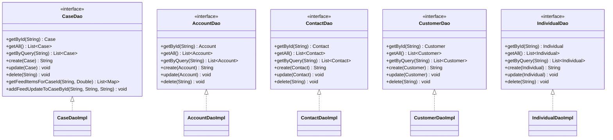

### 2.4 Layer 4: Implementation & Integration

**Purpose**: Implement service interfaces and integrate with Salesforce APIs

#### Core Components:

1. **SalesforceService** - Central API interaction manager
   - Performs CRUD operations on Salesforce sObjects
   - Manages HTTP requests/responses using ScribeJava
   - Handles feed element posting with attachments
   - Provides object metadata checking
   - API Version: v53.0

2. **SalesforceTokenProvider** - OAuth token management
   - `getSalesforceTokenForUser()` - User-specific token
   - `getSalesforceTokenForAdmin()` - Admin token
   - Token refresh and expiration handling
   - Secure token storage via RefreshTokenStore

3. **DAO Implementations** (5 classes):
   - **CaseDaoImpl**: Case CRUD + feed operations
   - **AccountDaoImpl**: Account CRUD operations
   - **ContactDaoImpl**: Contact CRUD operations
   - **CustomerDaoImpl**: Customer CRUD operations
   - **IndividualDaoImpl**: Individual CRUD operations

4. **ValidationOrchestrator** - Validation coordination
   - Manages 7 validators
   - Orchestrates validation across multiple resources
   - Returns structured validation results

5. **ExtensionResponseGenerator** - Response generation
   - Generates confirmation responses
   - Generates fetch responses
   - Generates fetch deny responses
   - Creates remediation actions

6. **ErrorHandlingStateManager** - State management
   - Stores error state using KeyValueStore
   - Retrieves state for error recovery
   - Manages internal state across requests

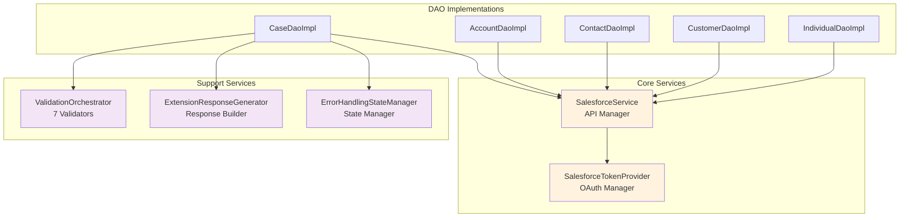

#### SalesforceService Key Methods:

| Method | Purpose | API Endpoint |
|--------|---------|--------------|
| `getById(id, subject)` | Retrieve record by ID | `/sobjects/{type}/{id}` |
| `getAll(subject)` | Retrieve all records | `/query?q=SELECT...` |
| `getByQuery(query)` | Custom SOQL query | `/query?q={query}` |
| `create(subject, body)` | Create new record | `/sobjects/{type}` |
| `update(id, subject, body)` | Update existing record | `/sobjects/{type}/{id}` |
| `delete(id, subject)` | Delete record | `/sobjects/{type}/{id}` |
| `postFeedElement(...)` | Post feed with attachment | `/chatter/feed-elements` |
| `checkObjectExists(type)` | Check object metadata | `/sobjects/{type}/describe` |

### 2.5 Layer 5: Model & Entity Layer

**Purpose**: Data models, entities, validators, and utilities

#### Components:

1. **SF* Models** (Salesforce API Response Models):
   - **SFCase**: Salesforce Case API model
   - **SFAccount**: Salesforce Account API model
   - **SFContact**: Salesforce Contact API model
   - **SFCustomer**: Salesforce Customer API model
   - **SFIndividual**: Salesforce Individual API model
   - **SFFeedItem**: Feed item response model
   - **SFCustomField**: Custom field metadata model

2. **Catalog Entities** (Krista Extension Entities):
   - **Case**: 18 fields (Id, ContactId, AccountId, Subject, Status, Priority, etc.)
   - **Account**: 17 fields (Id, Name, Type, Fax, AccountNumber, addresses, etc.)
   - **Contact**: 11 fields (Name, Title, AccountId, Phone, Email, etc.)
   - **Customer**: 5 fields (Id, PartyId, Name, CustomerStatusType, TotalLifeTimeValue)
   - **Individual**: Fields include Id, FirstName, LastName, BirthDate
   - All entities: `@Entity` with `primaryKey = "Id"`, `supportStore = true`

3. **Validators** (7 validators):
   - **CaseIdValidator**: Validates case ID existence
   - **NumberOfPostsValidator**: Validates post count (1-100)
   - **UpdateMessageValidator**: Validates message content
   - **FileValidator**: Validates file format and size
   - **ObjectIdValidator**: Validates object ID existence
   - **ObjectTypeValidator**: Validates object type
   - **CustomFieldsValidator**: Validates custom field names

4. **Utilities**:
   - **Constants**: Application constants and GSON instance
   - **DatePlus**: Date manipulation utilities
   - **Validators**: Common validation utilities
   - **SFObjectHelper**: Salesforce object helper methods
   - **StringHelper**: String manipulation utilities
   - **CaseQueryBuilder**: SOQL query builder for cases

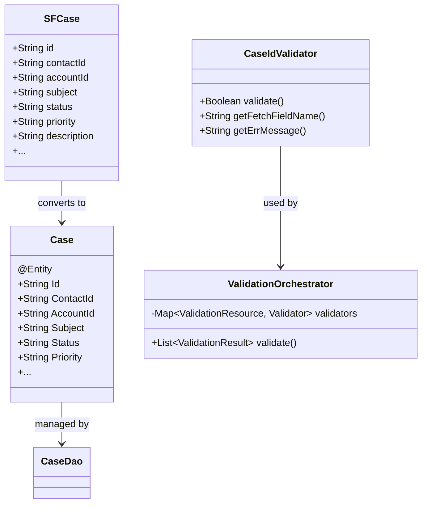

---

## 3. Component Architecture

### 3.1 High-Level Component Diagram

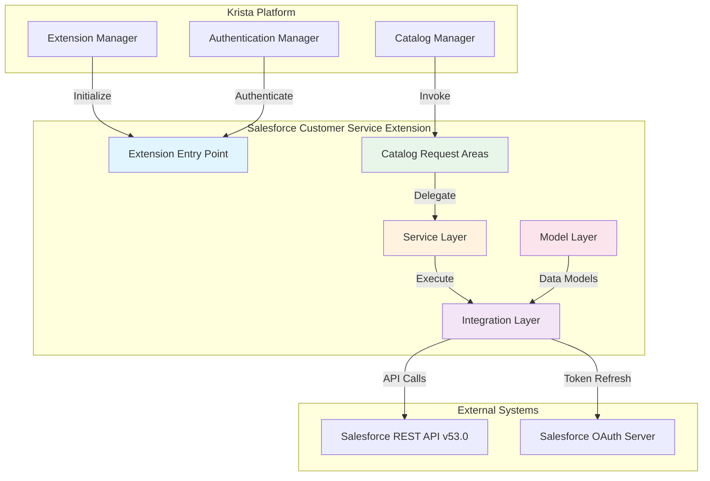


### 3.2 Dependency Injection Architecture

The extension uses JSR-330 (javax.inject) for dependency injection with HK2 as the DI container.

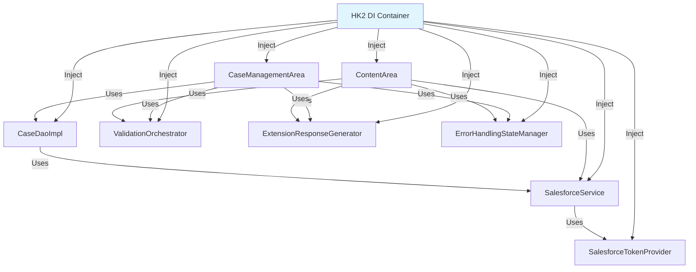

**Injection Points**:

1. **Constructor Injection** (Preferred):
   ```java
   @Inject
   private CaseManagementArea(CaseDaoImpl caseDao,
                              KristaMediaClient kristaMediaClient,
                              ValidationOrchestrator validationOrchestrator,
                              ExtensionResponseGenerator responseGenerator,
                              ErrorHandlingStateManager internalStateManager) {
       // Constructor injection
   }
   ```

2. **Service Annotation**:
   ```java
   @Service
   public class SalesforceService {
       // HK2 managed service
   }
   ```

### 3.3 Component Interactions

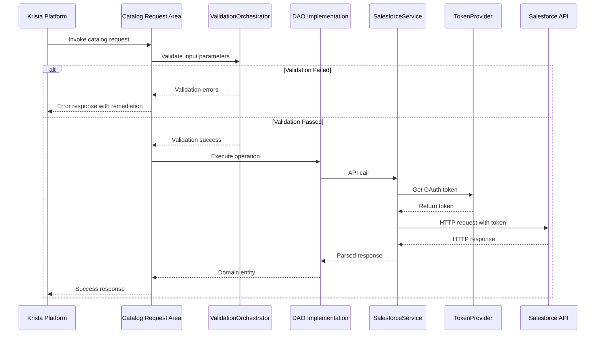

---

## 4. Data Flow Architecture

### 4.1 Request Processing Flow

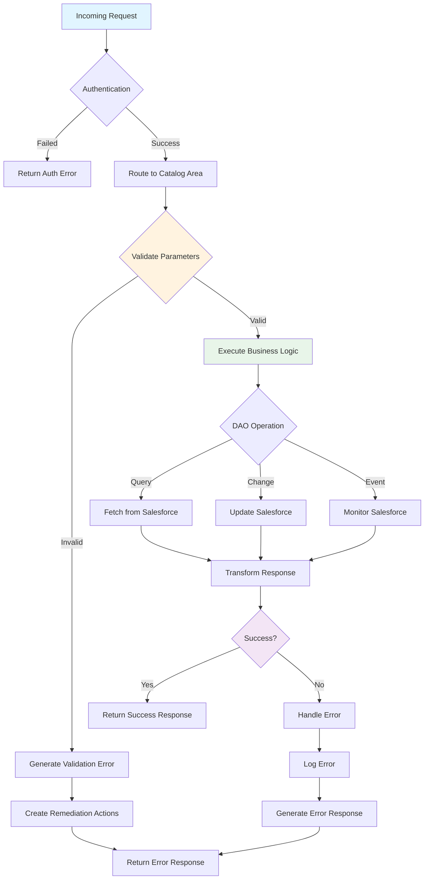

### 4.2 Query Execution Flow

**Example: Get Case Feed Items By Case Id**

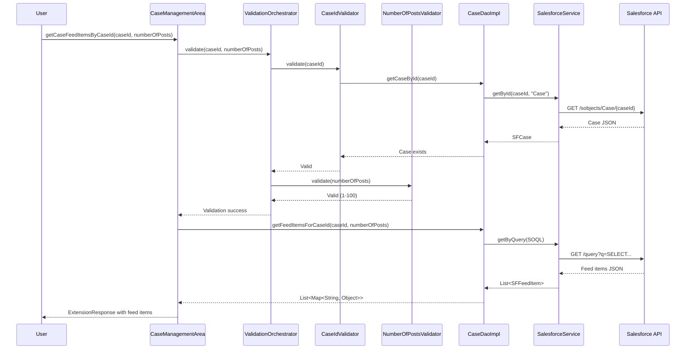

### 4.3 CRUD Operation Flow

**Create/Update/Delete Operations**

```mermaid
flowchart LR
    A[Catalog Request] --> B[Validate Input]
    B --> C{Valid?}
    C -->|No| D[Return Error]
    C -->|Yes| E[DAO Implementation]
    E --> F[SalesforceService]
    F --> G[Get OAuth Token]
    G --> H[Build HTTP Request]
    H --> I{Operation Type}
    I -->|Create| J[POST /sobjects/{type}]
    I -->|Update| K[PATCH /sobjects/{type}/{id}]
    I -->|Delete| L[DELETE /sobjects/{type}/{id}]
    J --> M[Salesforce API]
    K --> M
    L --> M
    M --> N{Success?}
    N -->|Yes| O[Parse Response]
    N -->|No| P[Handle API Error]
    O --> Q[Return Success]
    P --> R[Log Error]
    R --> S[Return Error Response]

    style B fill:#fff3e0
    style E fill:#e8f5e9
    style F fill:#f3e5f5
    style M fill:#e1f5ff
```

### 4.4 Event Monitoring Flow

**Case Change Alert (WAIT_FOR_EVENT)**

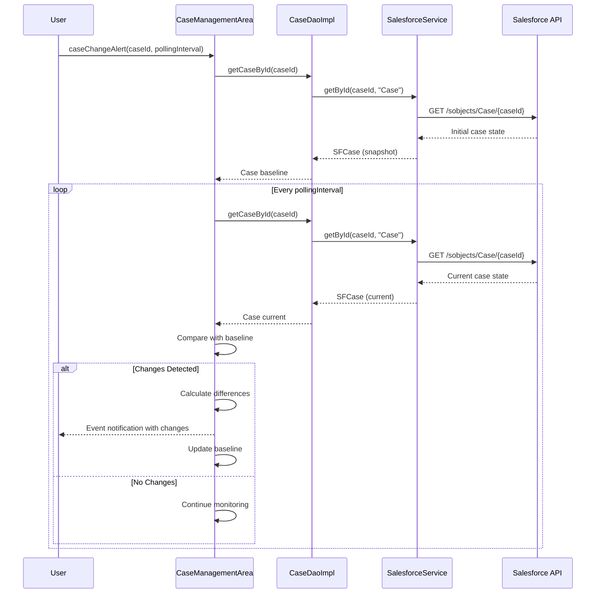

---

## 5. Authentication & Authorization

### 5.1 OAuth 2.0 Flow

The extension supports OAuth 2.0 authentication with Salesforce:

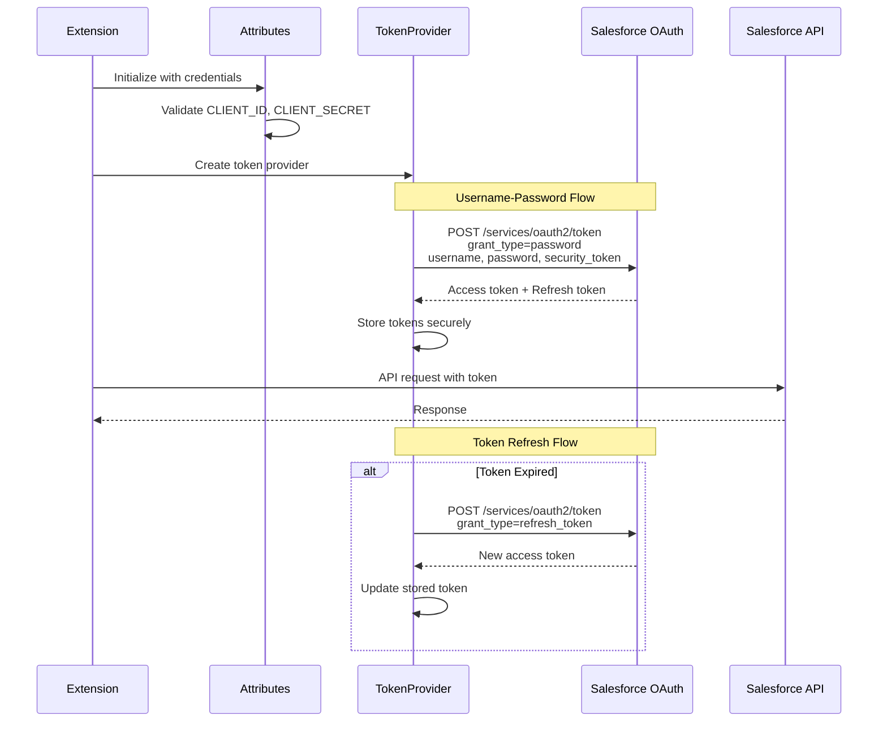
    style U fill:#f3e5f5
    style V fill:#f3e5f5

