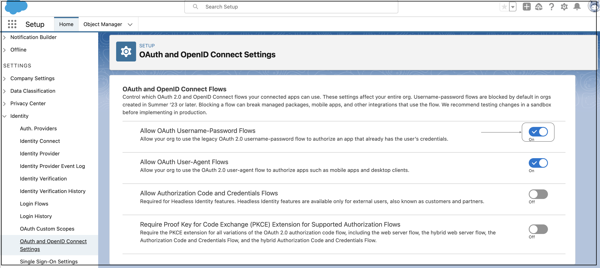
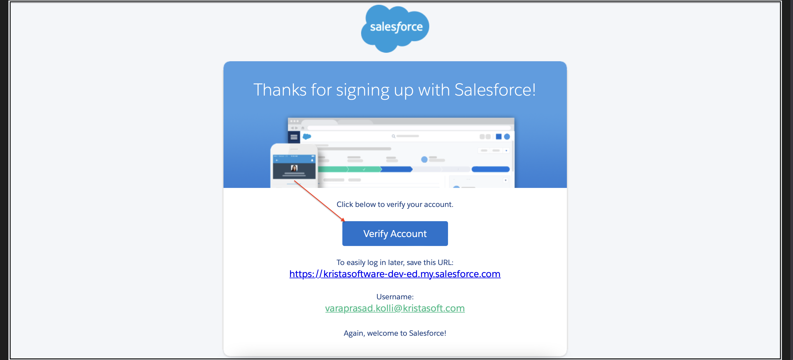
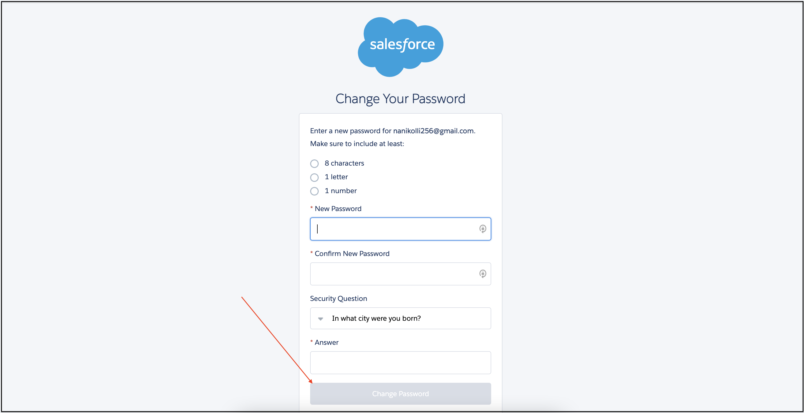

# Authentication

## Overview

The Krista Salesforce Customer Service Extension uses OAuth 2.0 for secure authentication with Salesforce. The extension supports four authentication flows to accommodate different use cases, from one-click Quick Setup to interactive user sign-in to fully automated service-account workflows.

> **🆕 What changed in 2.0.18.** Authentication is now powered by Krista's centralized OAuth substrate. The Authentication tab UI is the **SDK-bundled themed form** (replacing the legacy Invoker form), and **Quick Setup** is a new flow that lets you connect without creating a Salesforce Connected App at all. Existing refresh tokens are preserved across the upgrade — no re-authorization required. PKCE remains intentionally off (preserves compatibility with classic Connected Apps); see the [Changelog](../../docs/CHANGELOG.md) for the migration path when Salesforce mandates PKCE for new ISV apps.

## Authentication tab

The Authentication tab in Krista Studio surfaces a flow picker. Pick the flow that matches your use case, fill in the (flow-specific) fields, click **Test Connection** to verify, then **Save Changes** to persist. Krista will use the saved flow for every subsequent catalog request from this invoker.

## Authentication Modes

The extension supports four authentication flows. Pick one based on how you want users to identify themselves and whether you have a Connected App.

### Quick Setup (Krista-managed Connected App)

**When to Use**:
- You want the fastest possible path to a working connection
- You don't want to create or manage a Salesforce Connected App
- You're fine with the operator's identity being represented by their email address rather than a service account

**How It Works**:
1. Operator opens the Authentication tab and selects **Quick Setup**
2. Operator enters their admin email and the Sandbox toggle, clicks **Authorize**
3. Krista's central platform handler opens the Salesforce OAuth consent popup, signed by Krista's managed Connected App
4. Operator approves the OAuth consent
5. Salesforce redirects to the central Krista callback URL; the platform forwards the response to this extension's `/v3/oauth/callback` endpoint
6. Refresh token is stored under a per-admin-email key (`sfv1/{email}/...`) — multiple admins can coexist without overwriting each other

**Configuration Required**:
- Admin email (used as the per-admin identity)
- Sandbox toggle (use `test.salesforce.com` instead of `login.salesforce.com`)

No Client ID, Client Secret, or Connected App configuration is needed — Krista provides those.

**Best for**: Greenfield deployments, demos, organizations without a dedicated Salesforce admin.

---

### User Sign-In (Authorization Code Flow)

**When to Use:**
- Interactive conversations where actions should be performed as the authenticated user
- When you need user-specific permissions and audit trails
- When different users need different levels of access
- For conversations that require user consent

**How It Works:**
1. User initiates a conversation that requires Salesforce access
2. Extension redirects user to Salesforce login page
3. User authenticates with their Salesforce credentials
4. Salesforce redirects back to Krista with an authorization code
5. Extension exchanges the code for access and refresh tokens
6. Tokens are stored securely for the user's session

**Configuration Required:**
- Client ID
- Client Secret
- Redirect URI (automatically configured)

**In Krista Conversations:**
- Check the **"Have people authenticate with their account"** checkbox in the **Ask a System** step
- Users will be prompted to authenticate on first use
- Subsequent requests use the stored tokens automatically

### Server-to-Server (Client Credentials Flow)

**When to Use**:
- Automated workflows that run without any user interaction
- A single shared service-account identity is acceptable
- You can configure a "Run As User" on your Salesforce Connected App

**How It Works**:
1. Extension sends `grant_type=client_credentials` to the org's **My Domain** token endpoint
2. Salesforce returns an access token bound to the Connected App's configured Run-As user
3. Extension uses the access token directly — no refresh tokens are issued for this flow (Salesforce returns a fresh token on each call)

**Configuration Required**:
- Client ID
- Client Secret
- **Instance URL** — your Salesforce My Domain (e.g. `https://mycompany.my.salesforce.com`)
- Sandbox toggle

> **⚠️ Important Salesforce-specific behaviour.** Unlike Authorization Code, the Client Credentials token request must be sent to your org's **My Domain URL**, *not* `login.salesforce.com`. Hitting `login.salesforce.com` returns `invalid_grant: request not supported on this domain`. The extension handles this correctly when you fill in the Instance URL — make sure that field is set.

**Salesforce Connected App requirements for this flow**:
- "Enable Client Credentials Flow" must be checked in the Connected App's OAuth Policies
- A "Run As User" must be assigned in the Connected App's OAuth Policies
- The Run-As user must have all the object/field permissions the catalog requests need

**Best for**: Background jobs, scheduled flows, server-to-server integrations.

---

### Username + Password Flow (Legacy)

**When to Use:**
- Automated workflows that run without user interaction
- Scheduled tasks and background processes
- System-to-system integration
- When all actions should be performed as a single service account

**How It Works:**
1. Extension authenticates using the configured username, password, and security token
2. Salesforce returns access and refresh tokens
3. Extension uses these tokens for all API calls
4. Tokens are refreshed automatically when they expire

**Configuration Required:**
- Client ID
- Client Secret
- Username (service account)
- Password (service account)
- Security Token (service account)

**In Krista Conversations:**
- Leave the **"Have people authenticate with their account"** checkbox **unchecked** in the **Ask a System** step
- All requests execute automatically using the service account
- No user interaction required

> **ℹ️ Note**: Username + Password is a legacy flow that Salesforce is gradually phasing out for new ISV apps. Use **Server-to-Server** (Client Credentials) instead when possible — it doesn't require a stored user password and is the Salesforce-recommended pattern for service accounts.

---

## Quick reference — picking a flow

| Flow | User Interaction | Requires Connected App | Required fields | Best for |
|---|---|---|---|---|
| **Quick Setup** | Once, per admin | ❌ No (Krista-provided) | Email, Sandbox | Demos, greenfield, no Salesforce admin |
| **User Sign-In** | Each user, once | ✅ Yes | Client ID, Client Secret | Audit trails per real user |
| **Server-to-Server** | None | ✅ Yes (with Run-As user) | Client ID, Client Secret, Instance URL | Automation, background jobs |
| **Username + Password** | None | ✅ Yes | Client ID, Client Secret, Username, Password, Security Token | Legacy compatibility only |

## OAuth 2.0 Scopes and Permissions

### Required Scopes

The extension requests the following OAuth scopes from Salesforce:

| Scope | Full URL | Description | Permission Level |
|-------|----------|-------------|------------------|
| `api` | `https://[instance].salesforce.com/services/oauth2/scope/api` | Access to Salesforce APIs | Full API access to all objects and data the user has permissions for |
| `refresh_token` | `https://[instance].salesforce.com/services/oauth2/scope/refresh_token` | Ability to refresh access tokens | Allows the extension to obtain new access tokens without re-authentication |

**Why These Scopes:**
- **`api`**: Required for all catalog requests and entity operations. Provides access to REST API endpoints for Case, Contact, Account, and other objects.
- **`refresh_token`**: Essential for long-running sessions. Allows automatic token refresh without requiring users to re-authenticate frequently.

**Alternative Scopes:**
- **`full`**: Provides full access to all data and APIs. Not used by default as it's broader than necessary and may raise security concerns.
- **`web`**: Limited to web-based access. Not sufficient for API operations required by this extension.

### Salesforce Permissions

In addition to OAuth scopes, the authenticated user (or service account) must have the following Salesforce permissions:

**Object-Level Permissions:**
- Read, Create, Edit, Delete on: Case, Contact, Account, Individual, Customer
- Read access to: FeedItem, FeedComment (for case feed operations)

**Field-Level Security:**
- Read/Write access to all standard and custom fields used in catalog requests
- Custom fields must be visible to the user's profile

**System Permissions:**
- API Enabled
- View All Data (for service accounts performing broad queries)
- Modify All Data (for service accounts performing updates)

## OAuth 2.0 Grant Types

### Authorization Code Grant

**Grant Type**: `authorization_code`

**Used For**: Initial user authentication in the Authorization Code flow

**Flow**:
1. User is redirected to Salesforce authorization URL
2. User logs in and grants permissions
3. Salesforce redirects to callback URL with authorization code
4. Extension exchanges code for tokens

**Request Example**:
```http
POST /services/oauth2/token HTTP/1.1
Host: login.salesforce.com
Content-Type: application/x-www-form-urlencoded

grant_type=authorization_code
&code=aPrxhgZ1wG_Lh...
&client_id=3MVG9fTLmJ60pJ5...
&client_secret=1234567890ABCDEF...
&redirect_uri=https://krista.mycompany.com/rest/salesforcecustomerservice/callback
```

**Response Example**:
```json
{
  "access_token": "00D5w000000abcd!AR8AQP0jITN80ESEsj5EbaZTFG0RNBaT1cyWk7TrqoDjoNIWQ2ME_sTZzBjfmOE6zMHq6y8PIW4eWze9JksNEkWUl.Cju7m4",
  "refresh_token": "REDACTED_SECRET",
  "instance_url": "https://mycompany.my.salesforce.com",
  "id": "https://login.salesforce.com/id/00D5w000000abcdEAA/0055w000000abcdAAA",
  "token_type": "Bearer",
  "issued_at": "1638360000000",
  "signature": "xyz123..."
}
```

### Refresh Token Grant

**Grant Type**: `refresh_token`

**Used For**: Obtaining new access tokens when the current token expires

**Flow**:
1. Access token expires (after 1-2 hours)
2. Extension automatically uses refresh token to request new access token
3. Salesforce returns new access token
4. Extension continues operations seamlessly

**Request Example**:
```http
POST /services/oauth2/token HTTP/1.1
Host: login.salesforce.com
Content-Type: application/x-www-form-urlencoded

grant_type=refresh_token
&refresh_token=5Aep861TSESvWeug_xvFHRBTTbf_YrTWgEyjBJo7Xr34...
&client_id=3MVG9fTLmJ60pJ5...
&client_secret=1234567890ABCDEF...
```

**Response Example**:
```json
{
  "access_token": "00D5w000000abcd!AR8AQNewAccessTokenHere...",
  "instance_url": "https://mycompany.my.salesforce.com",
  "id": "https://login.salesforce.com/id/00D5w000000abcdEAA/0055w000000abcdAAA",
  "token_type": "Bearer",
  "issued_at": "1638363600000",
  "signature": "abc456..."
}
```

### Username-Password Grant (Resource Owner Password Credentials)

**Grant Type**: `password`

**Used For**: Service account authentication with username and password



**Flow**:
1. Extension sends username, password, and security token to Salesforce
2. Salesforce validates credentials and returns tokens
3. Extension stores and uses tokens for API calls

**Request Example**:
```http
POST /services/oauth2/token HTTP/1.1
Host: login.salesforce.com
Content-Type: application/x-www-form-urlencoded

grant_type=password
&client_id=3MVG9fTLmJ60pJ5...
&client_secret=1234567890ABCDEF...
&username=serviceaccount@company.com
&password=MyP@ssw0rdAbCdEfGhIjKlMnOp
```

> **📝 Note**: The password parameter should be the user's password concatenated with their security token (password + security token).

**Response Example**:
```json
{
  "access_token": "00D5w000000abcd!AR8AQServiceAccountToken...",
  "instance_url": "https://mycompany.my.salesforce.com",
  "id": "https://login.salesforce.com/id/00D5w000000abcdEAA/0055w000000serviceAAA",
  "token_type": "Bearer",
  "issued_at": "1638360000000",
  "signature": "def789..."
}
```

## Authentication Flow

### User Authentication Flow (Step-by-Step)

1. **User Initiates Request**
   - User starts a conversation that requires Salesforce access
   - Extension detects that user is not authenticated

2. **Authorization Request**
   - Extension generates authorization URL with state parameter
   - User is redirected to Salesforce login page
   - URL format: `https://login.salesforce.com/services/oauth2/authorize?response_type=code&client_id=...&redirect_uri=...&state=...`

3. **User Authentication**
   - User enters Salesforce credentials
   - User reviews and approves requested permissions
   - Salesforce validates credentials



4. **Authorization Code Exchange**
   - Salesforce redirects to callback URL with authorization code
   - Extension receives callback at `/rest/salesforcecustomerservice/callback`
   - Extension extracts authorization code from query parameters

5. **Token Request**
   - Extension sends authorization code to Salesforce token endpoint
   - Salesforce validates code and returns access token and refresh token

6. **Token Storage**
   - Extension stores tokens securely for the user's session
   - Tokens are associated with the user's Krista account

7. **API Access**
   - Extension uses access token for all Salesforce API calls
   - User's conversation continues seamlessly

### Service Account Flow (Step-by-Step)

1. **Extension Initialization**
   - Extension loads service account credentials from configuration
   - Credentials include username, password, and security token

2. **Token Request**
   - Extension sends credentials to Salesforce token endpoint using password grant
   - Request includes client ID, client secret, username, and password+token

3. **Token Response**
   - Salesforce validates credentials
   - Returns access token and refresh token

4. **Token Storage**
   - Extension stores tokens for service account
   - Tokens are reused for all service account requests

5. **Automatic Refresh**
   - When access token expires, extension automatically uses refresh token
   - New access token is obtained without re-authentication

## Token Management

### Access Token

**Lifetime**: 1-2 hours (configurable in Salesforce session settings)

**Usage**: Included in the Authorization header of every API request

**Format**: `Authorization: Bearer <access_token>`

**Expiration Handling**:
- Extension automatically detects expired tokens
- Uses refresh token to obtain new access token
- Retries failed request with new token
- Process is transparent to users

### Refresh Token

**Lifetime**:
- **Verified Apps**: Refresh tokens do not expire (unless revoked)
- **Unverified Apps**: Refresh tokens expire after 90 days of inactivity

**Usage**: Used to obtain new access tokens without re-authentication

**Storage**: Stored securely in Krista's token store, encrypted at rest

**Revocation**: Tokens are revoked when:
- User explicitly revokes access in Salesforce
- User password is changed
- Administrator revokes access
- Security policy triggers revocation
- Token limit is reached (Salesforce has a limit on active tokens per user)

## Token Expiration Scenarios

### Scenario 1: Access Token Expiration

**When**: After 1-2 hours of token issuance

**What Happens**:
1. API request fails with 401 Unauthorized
2. Extension detects expired access token
3. Extension automatically uses refresh token to get new access token
4. Extension retries the original request
5. User experiences no interruption

**User Action Required**: None (automatic)

### Scenario 2: Refresh Token Expiration (Unverified Apps)

**When**: After 90 days of inactivity (for unverified Connected Apps)

**What Happens**:
1. Extension attempts to refresh access token
2. Refresh request fails (invalid refresh token)
3. Extension throws MustAuthorizeException
4. User is prompted to re-authenticate

**User Action Required**: Re-authenticate with Salesforce

**Prevention**: Use a verified Connected App or ensure regular usage

### Scenario 3: Token Revocation by User

**When**: User revokes access in Salesforce Settings → Connected Apps

**What Happens**:
1. All tokens for that user are immediately invalidated
2. Next API request fails with 401 Unauthorized
3. Extension prompts user to re-authenticate

**User Action Required**: Re-authenticate with Salesforce

### Scenario 4: Password Change

**When**: User changes their Salesforce password



**What Happens**:
1. All existing tokens are revoked by Salesforce
2. Next API request fails
3. Extension prompts user to re-authenticate

**User Action Required**: Re-authenticate with new password

### Scenario 5: Token Limit Reached

**When**: User has too many active tokens (Salesforce limit varies by edition)

**What Happens**:
1. Oldest tokens are automatically revoked
2. If extension's token is revoked, next request fails
3. Extension prompts user to re-authenticate

**User Action Required**: Re-authenticate (consider revoking unused app tokens in Salesforce)

## Security Best Practices

### 1. Credential Management
- Store Client Secret securely; never expose in client-side code
- Use strong passwords for service accounts
- Rotate service account passwords regularly (every 90 days recommended)
- Use dedicated service accounts; don't share with human users

### 2. Token Security
- Tokens are stored encrypted in Krista's secure token store
- Never log or display tokens in conversations or logs
- Revoke tokens immediately if compromised
- Monitor token usage in Salesforce Setup → Identity → OAuth and OpenID Connect

### 3. Permission Minimization
- Grant only the minimum required Salesforce permissions
- Use permission sets for granular control
- Regularly audit service account permissions
- Avoid using "View All Data" and "Modify All Data" unless necessary

### 4. Network Security
- Always use HTTPS for all communications
- Whitelist Krista appliance IP addresses in Salesforce if using IP restrictions
- Use Salesforce Login IP Ranges to restrict service account access
- Enable Multi-Factor Authentication (MFA) for human users (not service accounts)

### 5. Monitoring and Auditing
- Review Salesforce Login History regularly
- Monitor API usage in Salesforce Setup → System Overview
- Set up alerts for unusual authentication patterns
- Use Salesforce Event Monitoring for detailed audit trails

## Troubleshooting Authentication

### Issue: "OAuth configuration is incomplete due to missing Client ID"

**Cause**: A valid Salesforce Client ID is required for authentication.

**Resolution**:
1. Obtain the Client ID from your Salesforce Connected App
2. Enter it in the extension configuration
3. Refer to [Creating Salesforce App](pages/CreatingSalesforceApp.md) for detailed steps

### Issue: "OAuth configuration is incomplete due to missing Client Secret"

**Cause**: A valid Salesforce Client Secret is required for authentication.

**Resolution**:
1. Obtain the Client Secret from your Salesforce Connected App
2. Enter it in the extension configuration
3. Ensure the Connected App allows the required OAuth flows

### Issue: "Authentication failed due to invalid client credentials"

**Cause**: The Client ID or Client Secret provided is incorrect or expired.

**Resolution**:
1. Verify your Salesforce Connected App credentials in the extension configuration
2. Ensure they match your Salesforce setup exactly
3. Check that the Connected App is active and not expired
4. Regenerate Client Secret if necessary

### Issue: "Authentication failed due to invalid user credentials"

**Cause**: The username, password, or security token provided is incorrect or expired.

**Resolution**:
1. Verify your Salesforce username, password, and security token in the extension configuration
2. If using a security token, ensure it's current and appended to your password
3. Reset your security token if it has expired
4. Ensure the user account is active and has API access

### Issue: "Domain validation failed due to invalid protocol"

**Cause**: The domain URL must start with 'http://' or 'https://' (HTTPS is recommended for security).

**Resolution**:
1. Update your domain URL to include the proper protocol
2. Use format: `https://yourcompany.my.salesforce.com`
3. Avoid using HTTP in production environments

### Issue: "OAuth service initialization failed"

**Cause**: The system could not create the OAuth service due to configuration issues.

**Resolution**:
1. Verify your Client ID and Client Secret are correct
2. Ensure the callback URL is properly configured
3. Check that your Salesforce Connected App settings allow the required OAuth flows
4. Verify network connectivity to Salesforce
5. For custom domains, check that your domain URL format is valid
4. Ensure password and token are entered correctly (password+token concatenated)

### Issue: "User Not Authorized"

**Cause**: User or service account lacks required permissions

**Resolution**:
1. Verify API Enabled permission
2. Check object and field-level permissions
3. Ensure user profile has necessary access
4. Review Connected App policies and IP restrictions

## See Also

- [Extension Configuration](pages/ExtensionConfiguration.md)
- [Creating Salesforce Connected App](pages/CreatingSalesforceApp.md)
- [Troubleshooting Guide](pages/Troubleshooting.md)

