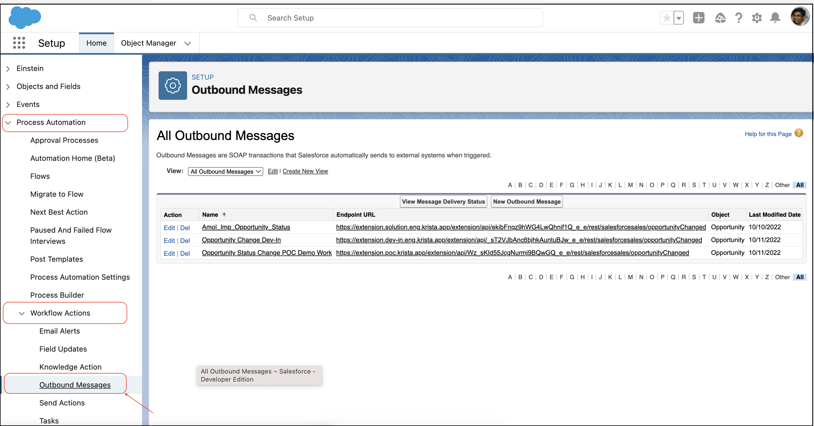
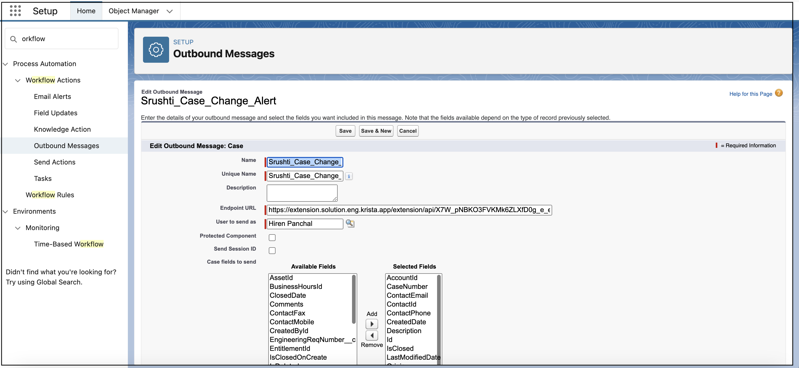
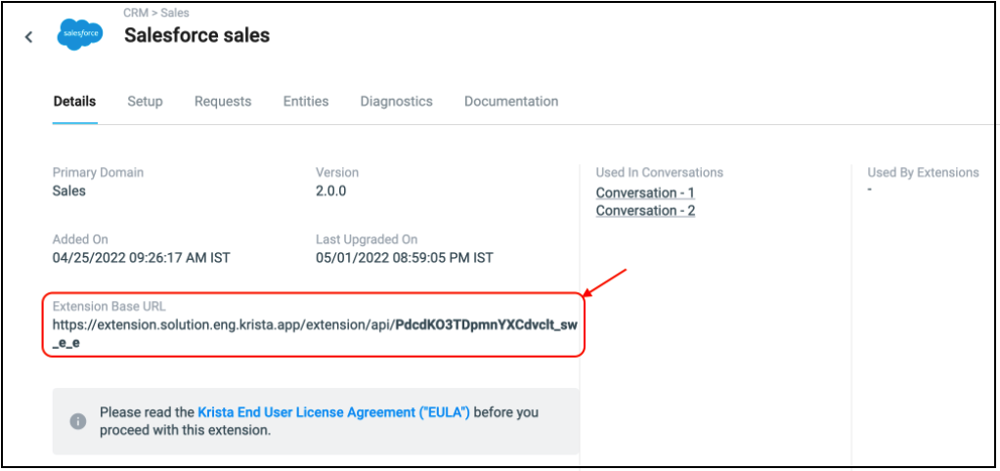
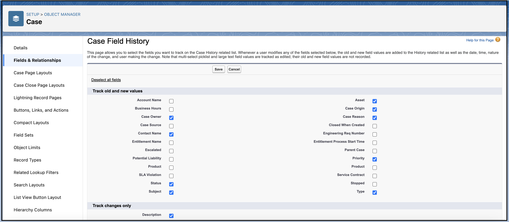
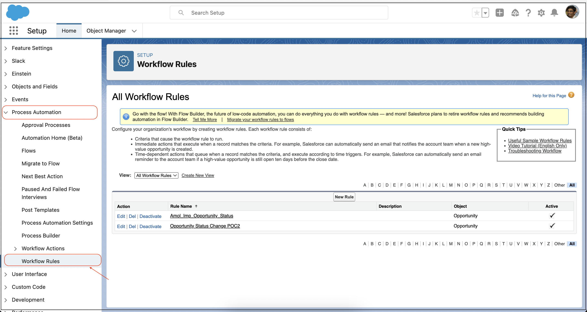
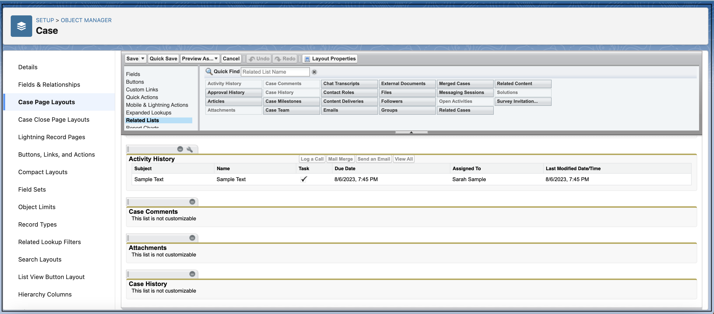

# Case Change Alert

## Overview

Receives real-time notifications when cases are created or updated in Salesforce. This request enables event-driven workflows that respond automatically to case changes without polling.

## Request Details

- **Area**: Case Management
- **Type**: WAIT_FOR_EVENT
- **Retry Support**: ❌ No - This is an event-driven request that waits for Salesforce outbound messages

## Input Parameters

This request does not require any input parameters. It waits for events triggered by Salesforce Workflow Rules and Outbound Messages.

## Output Parameters

| Parameter Name | Type | Description |
|----------------|------|-------------|
| CaseResponse | MultiField | Object containing all case details from the change event |

### CaseResponse Structure

| Field Name | Type | Description |
|------------|------|-------------|
| Case Id | Text | Unique Salesforce ID of the case |
| Case Contact Id | Text | ID of the contact associated with the case |
| Case Account Id | Text | ID of the account associated with the case |
| Case Subject | Text | Subject/title of the case |
| Case Is Closed | Boolean | Whether the case is closed |
| Case Owner Id | Text | ID of the case owner (user) |
| Case Created Date | Date | Date and time when the case was created |
| Case Last Modified Date | Date | Date and time when the case was last modified |
| Case Number | Number | Auto-generated case number |
| Case Status | Text | Current status of the case (New, In Progress, Closed, etc.) |
| Case Reason | Text | Reason for the case |
| Case Origin | Text | Origin of the case (Phone, Email, Web, etc.) |
| Case Description | Paragraph | Detailed description of the case |
| Case Priority | Text | Priority level (High, Medium, Low) |

**Example Output**:
```json
{
  "CaseResponse": {
    "Case Id": "5005w00000AlDtDAAV",
    "Case Contact Id": "0035w00000BxYzAAK",
    "Case Account Id": "0015w00000CzXyBBB",
    "Case Subject": "Product not working as expected",
    "Case Is Closed": false,
    "Case Owner Id": "0055w00000DaZaBCC",
    "Case Created Date": "2025-01-15T10:30:00Z",
    "Case Last Modified Date": "2025-01-15T14:45:00Z",
    "Case Number": 12345,
    "Case Status": "In Progress",
    "Case Reason": "Performance",
    "Case Origin": "Phone",
    "Case Description": "Customer reports slow performance when using the application",
    "Case Priority": "High"
  }
}
```

## Salesforce Configuration Required

To use this catalog request, you must configure Salesforce to send outbound messages when cases change. This involves creating a Workflow Rule and an Outbound Message.

### Prerequisites

1. **Admin Access**: You need Salesforce administrator permissions
2. **Routing ID**: Your Krista extension's routing ID (found in the extension details page)
3. **Endpoint URL**: Construct the endpoint URL using your routing ID

**Endpoint URL Format**:
```
[Your Routing ID]/rest/salesforcecustomerservice/casechanged
```

**Example**:
```
https://krista.mycompany.com/rest/salesforcecustomerservice/casechanged
```

### Step-by-Step Salesforce Setup

#### Step 1: Create Outbound Message

1. In Salesforce, click the **Setup** icon (⚙️) and select **Setup**
2. In the Quick Find box, search for **"Outbound Messages"**
3. Navigate to **Process Automation** → **Workflow Actions** → **Outbound Messages**



4. Click **New Outbound Message**

#### Step 2: Configure Outbound Message

1. **Object**: Select **Case**
2. Click **Next**



3. **Name**: Enter a descriptive name (e.g., "Krista Case Change Notification")
4. **Unique Name**: Auto-populated (e.g., "Krista_Case_Change_Notification")
5. **Endpoint URL**: Enter your Krista endpoint URL
   - Format: `[Routing ID]/rest/salesforcecustomerservice/casechanged`
   - Example: `https://krista.mycompany.com/rest/salesforcecustomerservice/casechanged`



6. **User to send as**: Select a user (typically an integration user or admin)
7. **Protected Component**: Leave unchecked (unless required by your org)

#### Step 3: Select Case Fields

Select the case fields you want to include in the outbound message. At minimum, select:



**Required Fields**:
- Id
- ContactId
- AccountId
- Subject
- IsClosed
- OwnerId
- CreatedDate
- LastModifiedDate
- CaseNumber
- Status
- Reason
- Origin
- Description
- Priority

> **💡 Tip**: You can select additional standard or custom fields as needed. All selected fields will be included in the event payload.

8. Click **Save**

#### Step 4: Create Workflow Rule

1. In Setup, search for **"Workflow Rules"** in the Quick Find box
2. Navigate to **Process Automation** → **Workflow Rules**



3. Click **New Rule**
4. If prompted, select **Continue with Workflow Rules**

#### Step 5: Configure Workflow Rule

1. **Object**: Select **Case**
2. Click **Next**



3. **Rule Name**: Enter a descriptive name (e.g., "Notify Krista on Case Change")
4. **Description**: Optional description (e.g., "Sends outbound message to Krista when cases are created or updated")

#### Step 6: Set Evaluation Criteria

Choose when the rule should be evaluated:

**Option 1: Created, and every time it's edited** (Recommended)
- Triggers on both case creation and updates
- Best for comprehensive case monitoring

**Option 2: Created, and any time it's edited to subsequently meet criteria**
- Triggers only when criteria are met
- Use if you want to filter specific case changes

**Option 3: Every time a record is created**
- Triggers only on case creation
- Use if you only need new case notifications

> **📝 Recommendation**: Select "Created, and every time it's edited" to receive all case change events.

#### Step 7: Set Rule Criteria

Define when the workflow should trigger:

**Option 1: Run this rule if the following criteria are met** (Recommended)
- Add criteria to filter which cases trigger the alert
- Example: `Case: Priority EQUALS High` (only high-priority cases)
- Example: `Case: Status NOT EQUAL TO Closed` (exclude closed cases)
- Leave blank to trigger on all case changes

**Option 2: Run this rule if the following formula evaluates to true**
- Use a formula for complex criteria
- Example: `AND(ISPICKVAL(Priority, "High"), NOT(ISPICKVAL(Status, "Closed")))`

> **💡 Tip**: Start with no criteria (all cases) and refine later based on your needs.

8. Click **Save & Next**

#### Step 8: Add Workflow Action

1. Click **Add Workflow Action**
2. Select **Select Existing Action**
3. **Action Type**: Select **Outbound Message**
4. **Available Actions**: Select the outbound message you created earlier (e.g., "Krista Case Change Notification")
5. Click the **Add** arrow to move it to Selected Actions
6. Click **Save**
7. Click **Done**

#### Step 9: Activate Workflow Rule

1. On the Workflow Rule detail page, click **Activate**
2. Confirm activation

> **⚠️ Important**: The workflow rule must be activated for outbound messages to be sent.

### Step 10: Enable Case History Tracking (Optional but Recommended)

To track changes to specific case fields:

1. In Setup, search for **"Object Manager"**
2. Select **Case**
3. Click **Fields & Relationships** in the left menu
4. Click **Set History Tracking** button
5. Check **Enable Case History**
6. Select the fields you want to track (e.g., Status, Priority, Owner, Description)
7. Click **Save**

8. Add Case History to Page Layout:
   - In Object Manager → Case, click **Page Layouts**
   - Select **Case Layout** (or your custom layout)
   - Click **Related Lists** in the palette
   - Drag **Case History** to the Related Lists section
   - Click **Save**

## Validation Rules

This request does not perform input validation since it receives events from Salesforce rather than user input.

## Error Handling

### Input Errors (INPUT_ERROR)

**Cause**: Malformed event data from Salesforce

**Common Scenarios**:
- Outbound message payload is missing required fields
- Event data cannot be parsed

**Resolution**:
- Verify all required case fields are selected in the outbound message configuration
- Check Salesforce outbound message delivery status
- Review Krista logs for parsing errors

### Logic Errors (LOGIC_ERROR)

**Cause**: Business logic failure during event processing

**Common Scenarios**:
- Event name doesn't match "Case Change Alert"
- Case data is incomplete or invalid

**Error Messages**:
- "Event name does not match 'Case Change Alert'"

**Resolution**:
- Verify the workflow rule is configured correctly
- Ensure the outbound message is associated with the Case object

### System Errors (SYSTEM_ERROR)

**Cause**: Unexpected system-level failures during event processing

**Common Scenarios**:
- Krista endpoint is unavailable
- Network connectivity issues
- Event processing timeout

**Error Messages**:
- "Error occurred while processing case change alert"

**Resolution**:
1. Verify Krista appliance is running and accessible
2. Check network connectivity between Salesforce and Krista
3. Review Salesforce outbound message delivery queue
4. Check Krista logs for detailed error information

### Authorization Errors

**Cause**: Authentication issues (rare for outbound messages)

**Common Scenarios**:
- Endpoint URL is incorrect
- Krista extension is not properly configured

**Resolution**:
1. Verify the endpoint URL in the outbound message matches your Krista routing ID
2. Ensure the extension is properly configured and active
3. Check that the routing path `/rest/salesforcecustomerservice/casechanged` is correct

## Usage Examples

### Example 1: New Case Created

**Salesforce Action**: User creates a new case with Priority = High

**Event Triggered**: Workflow rule triggers outbound message

**Krista Receives**:
```json
{
  "CaseResponse": {
    "Case Id": "5005w00000NewCaseAAA",
    "Case Subject": "Urgent: System Down",
    "Case Priority": "High",
    "Case Status": "New",
    "Case Created Date": "2025-01-15T09:00:00Z",
    "Case Last Modified Date": "2025-01-15T09:00:00Z",
    ...
  }
}
```

**Result**: Krista conversation is triggered, can automatically assign to on-call engineer or send notifications.

### Example 2: Case Status Updated

**Salesforce Action**: Agent changes case status from "New" to "In Progress"

**Event Triggered**: Workflow rule triggers outbound message

**Krista Receives**:
```json
{
  "CaseResponse": {
    "Case Id": "5005w00000AlDtDAAV",
    "Case Status": "In Progress",
    "Case Last Modified Date": "2025-01-15T10:30:00Z",
    ...
  }
}
```

**Result**: Krista can notify stakeholders of status change or update external systems.

### Example 3: High-Priority Case Escalation

**Salesforce Action**: Case priority changed from "Medium" to "High"

**Event Triggered**: Workflow rule (with criteria: Priority = High) triggers outbound message

**Krista Receives**:
```json
{
  "CaseResponse": {
    "Case Id": "5005w00000AlDtDAAV",
    "Case Priority": "High",
    "Case Subject": "Critical Production Issue",
    ...
  }
}
```

**Result**: Krista automatically escalates to senior support and sends urgent notifications.

## Business Rules

1. **Event-Driven**: This request waits for events from Salesforce; it does not poll or query
2. **Workflow Dependency**: Requires properly configured Salesforce Workflow Rule and Outbound Message
3. **Real-Time**: Events are sent in near real-time when cases change (typically within seconds)
4. **Guaranteed Delivery**: Salesforce retries failed outbound messages automatically
5. **All Fields Included**: All case fields selected in the outbound message are included in the event
6. **No Filtering in Request**: Filtering is done in Salesforce workflow criteria, not in the Krista request

## Limitations

1. **Salesforce Configuration Required**: Cannot be used without proper Salesforce workflow setup
2. **No Historical Events**: Only receives events for changes that occur after the workflow is activated
3. **Workflow Rule Limits**: Subject to Salesforce workflow rule limits (typically 50 active rules per object)
4. **Outbound Message Limits**: Subject to Salesforce outbound message limits and quotas
5. **Retry Delays**: Failed outbound messages are retried by Salesforce with exponential backoff (may take hours)
6. **No Batch Events**: Each case change triggers a separate event (no batching)

## Best Practices

### 1. Use Specific Workflow Criteria
Filter events in Salesforce to reduce unnecessary notifications. For example, only trigger on high-priority cases or specific status changes.

### 2. Monitor Outbound Message Queue
Regularly check Salesforce's outbound message delivery status to ensure messages are being delivered successfully.

### 3. Handle Duplicate Events
Salesforce may send duplicate outbound messages in rare cases. Design your Krista conversations to be idempotent.

### 4. Test in Sandbox First
Always test workflow rules and outbound messages in a Salesforce sandbox before deploying to production.

### 5. Document Workflow Rules
Maintain documentation of all workflow rules and their purposes to avoid confusion and conflicts.

## Common Use Cases

### 1. Automatic Case Assignment
```
Scenario: High-priority case is created
Event: Case Change Alert triggered
Action: Krista automatically assigns to on-call engineer
Result: Faster response time for critical cases
```

### 2. Stakeholder Notifications
```
Scenario: Case status changes to "Resolved"
Event: Case Change Alert triggered
Action: Krista sends notification to customer and account manager
Result: Improved communication and transparency
```

### 3. SLA Monitoring
```
Scenario: Case is created or updated
Event: Case Change Alert triggered
Action: Krista checks SLA compliance and sends alerts if at risk
Result: Proactive SLA management
```

### 4. External System Integration
```
Scenario: Case priority is escalated
Event: Case Change Alert triggered
Action: Krista creates ticket in external monitoring system
Result: Synchronized case management across systems
```

## Related Catalog Requests

- [Get Case Feed Items By Case Id](GetCaseFeedItemsByCaseId.md) - Retrieve feed items after receiving a case change alert
- [Share Update to Case](ShareUpdateToCase.md) - Post updates to cases in response to alerts

## Technical Implementation

### Helper Class
- **Class**: `CaseManagementArea`
- **Package**: `app.krista.extensions.crm.customer_relations.salesforce_customer_service.catalog`
- **Method**: `caseChangeAlert`

### Event Processing
- **Endpoint**: `/rest/salesforcecustomerservice/casechanged`
- **Protocol**: HTTP POST (Salesforce Outbound Message)
- **Payload**: SOAP XML (automatically parsed by the extension)
- **Response**: HTTP 200 OK (acknowledges receipt)

### Validation Flow
- Event name must match "Case Change Alert"
- Event data is parsed and converted to CaseResponse structure
- No user input validation required

### Telemetry Metrics
- Event receipt count
- Event processing time
- Event processing success/failure rates
- Salesforce outbound message delivery status

## Troubleshooting

### Issue: No Events Received

**Cause**: Workflow rule not activated or outbound message misconfigured

**Solution**:
1. Verify workflow rule is activated in Salesforce
2. Check outbound message endpoint URL is correct
3. Test by creating/updating a case that meets workflow criteria
4. Review Salesforce outbound message delivery queue (Setup → Outbound Messages → View Delivery Status)

### Issue: Events Delayed

**Cause**: Salesforce outbound message retry backoff

**Solution**:
1. Check Salesforce outbound message delivery status for failures
2. Verify Krista endpoint is accessible from Salesforce
3. Check for network/firewall issues
4. Review Krista logs for endpoint errors

### Issue: Duplicate Events

**Cause**: Salesforce retry mechanism or multiple workflow rules

**Solution**:
1. Design conversations to handle duplicate events (idempotency)
2. Check for multiple workflow rules triggering the same outbound message
3. Review Salesforce outbound message delivery logs

### Issue: Missing Case Fields

**Cause**: Fields not selected in outbound message configuration

**Solution**:
1. Edit the outbound message in Salesforce
2. Add the missing fields to the selected fields list
3. Save and test again

## See Also

- [Extension Configuration](ExtensionConfiguration.md)
- [Get Case Feed Items By Case Id](GetCaseFeedItemsByCaseId.md)
- [Share Update to Case](ShareUpdateToCase.md)
- [Salesforce Outbound Messages Documentation](https://developer.salesforce.com/docs/atlas.en-us.api.meta/api/sforce_api_om_outboundmessaging.htm)

