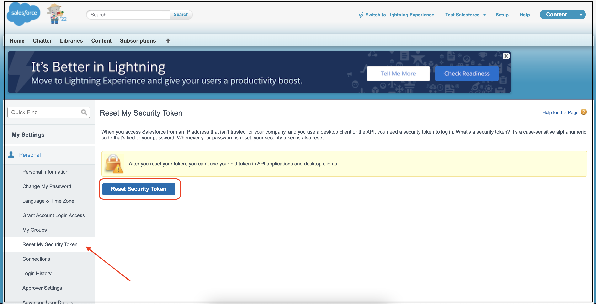
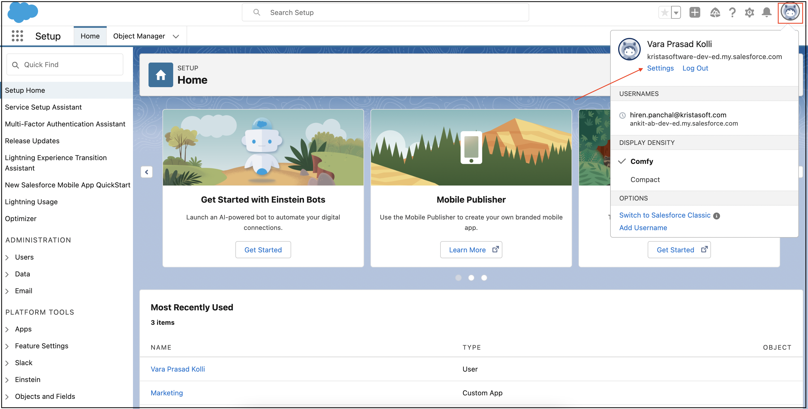

# Troubleshooting Guide

## Overview

This guide provides solutions to common issues you may encounter when using the Krista Salesforce Customer Service Extension. Issues are organized by category for easy reference.

---

## Configuration Issues

### Issue: Extension Not Appearing in Krista

**Symptoms**:
- Extension is not visible in the Krista extension list
- Cannot configure the extension

**Possible Causes**:
- Extension not properly installed
- Extension not enabled
- User lacks permissions to view extensions

**Solutions**:
1. Verify the extension is installed in your Krista environment
2. Check that the extension is enabled in the Krista admin panel
3. Ensure your user account has permissions to view and configure extensions
4. Restart the Krista appliance if recently installed
5. Check Krista logs for extension loading errors

### Issue: "OAuth configuration is incomplete due to missing Client ID"

**Symptoms**:
- Error message when saving extension configuration
- Extension fails to initialize during OAuth setup

**Cause**: A valid Salesforce Client ID is required for authentication.

**Solution**:
1. Obtain the Client ID from your Salesforce Connected App
2. Enter it in the extension configuration
3. Refer to [Creating Salesforce App](pages/CreatingSalesforceApp.md) for detailed steps

### Issue: "OAuth configuration is incomplete due to missing Client Secret"

**Symptoms**:
- Error message when saving extension configuration
- Authentication fails during setup

**Cause**: A valid Salesforce Client Secret is required for authentication.

**Solution**:
1. Obtain the Client Secret from your Salesforce Connected App
2. Enter it in the extension configuration
3. Ensure the Connected App allows the required OAuth flows

### Issue: "Domain validation failed due to invalid protocol"

**Symptoms**:
- Error when configuring custom Salesforce domain
- Domain URL validation fails

**Cause**: The domain URL must start with 'http://' or 'https://' (HTTPS is recommended for security).

**Solution**:
1. Update your domain URL to include the proper protocol
2. Use format: `https://yourcompany.my.salesforce.com`
3. Avoid using HTTP in production environments

### Issue: "Instance URL validation failed due to invalid format"

**Symptoms**:
- Instance URL configuration fails
- Invalid format error during setup

**Cause**: The Instance URL must be a valid URL with proper protocol and hostname.

**Solution**:
1. Use the correct format: `https://yourinstance.salesforce.com`
2. Ensure the hostname is valid and accessible
3. Verify the URL works in a web browser
5. Verify Security Token is current (reset if necessary)
6. Check the "Sandbox" checkbox if using a Salesforce sandbox environment

### Issue: Redirect URI Mismatch

**Symptoms**:
- "redirect_uri_mismatch" error during authentication
- OAuth flow fails after user authorizes

**Possible Causes**:
- Callback URL in Salesforce Connected App doesn't match Krista's callback URL
- Incorrect routing URL configuration

**Solutions**:
1. Get your Krista routing URL from the extension details page
2. Construct the correct callback URL: `[Routing URL]/rest/salesforcecustomerservice/callback`
3. Update the Salesforce Connected App's Callback URL to match exactly
4. Ensure there are no trailing slashes or extra characters
5. Save the Connected App and wait a few minutes for changes to propagate

---

## Authentication Issues

### Issue: "Authorization Failed" Error

**Symptoms**:
- Cannot authenticate with Salesforce
- "Authorization failed" message in Krista

**Possible Causes**:
- Invalid credentials
- Expired access token
- User not authorized in Salesforce Connected App
- Incorrect OAuth scopes

**Solutions**:
1. Verify Salesforce username and password are correct
2. Reset and update the Security Token if using Username-Password flow
3. For Authorization Code flow, ensure the user is authorized in the Connected App
4. Check that the Connected App has the correct OAuth scopes (`api` and `refresh_token`)
5. Verify the user's profile has API access enabled in Salesforce
6. Re-authenticate by clicking the authentication link in Krista

### Issue: Access Token Expired

**Symptoms**:
- Requests fail with "Session expired or invalid" error
- Authentication worked previously but now fails

**Possible Causes**:
- Access token has expired (typically after 1-2 hours)
- Refresh token has expired (90 days for unverified apps)
- User's Salesforce session was invalidated

**Solutions**:
1. For Authorization Code flow: Re-authenticate through the OAuth flow
2. For Username-Password flow: Extension will automatically obtain a new token
3. If refresh token expired, user must re-authorize the application
4. Check Salesforce session settings and timeout policies
5. Verify the Connected App is still active and not revoked

### Issue: "Invalid Grant" Error

**Symptoms**:
- "invalid_grant" error during token refresh
- Cannot obtain access token

**Possible Causes**:
- Refresh token has been revoked
- User's password was changed
- Security Token was reset
- User's permissions changed in Salesforce

**Solutions**:
1. Re-authenticate the user through the OAuth flow
2. If using Username-Password flow, update the password and security token in the configuration

3. Verify the user still has API access in Salesforce

4. Check that the user's profile hasn't been changed to restrict API access
5. Ensure the Connected App hasn't been revoked or disabled

### Issue: "Authentication failed due to invalid client credentials"

**Symptoms**:
- Authentication fails with client credential errors
- "invalid_client" error messages

**Cause**: The Client ID or Client Secret provided is incorrect or expired.

**Solution**:
1. Verify your Salesforce Connected App credentials in the extension configuration
2. Ensure they match your Salesforce setup exactly
3. Check that the Connected App is active and not expired
4. Regenerate Client Secret if necessary

### Issue: "Authentication failed due to invalid user credentials"

**Symptoms**:
- Username/password authentication fails
- "invalid_grant" error with user credentials

**Cause**: The username, password, or security token provided is incorrect or expired.

**Solution**:
1. Verify your Salesforce username, password, and security token in the extension configuration
2. If using a security token, ensure it's current and appended to your password
3. Reset your security token if it has expired
4. Ensure the user account is active and has API access

### Issue: "OAuth service initialization failed"

**Symptoms**:
- OAuth service cannot be created
- Extension fails to initialize authentication

**Cause**: The system could not create the OAuth service due to configuration issues.

**Solution**:
1. Verify your Client ID and Client Secret are correct
2. Ensure the callback URL is properly configured
3. Check that your Salesforce Connected App settings allow the required OAuth flows
4. Verify network connectivity to Salesforce
5. For custom domains, check that your domain URL format is valid

---

## Catalog Request Issues

### Issue: "Case operation failed because the Case ID is invalid or does not exist"

**Symptoms**:
- Error when trying to retrieve case feed items or share updates
- Case validation fails during catalog request execution

**Cause**: The Case ID is invalid or does not exist in Salesforce, or you don't have access to it.

**Solution**:
1. Verify the Case ID exists in your Salesforce system and you have access to it
2. Check that the Case ID is correctly formatted (15 or 18 characters)
3. Ensure you have read access to the case through sharing rules or ownership
4. Verify you're using the correct Salesforce environment (production vs sandbox)
5. Check that the case hasn't been deleted or archived

### Issue: "Post retrieval failed because the number of posts specified is invalid"

**Symptoms**:
- Error when trying to retrieve case feed items
- Number of posts validation fails

**Cause**: The number of posts must be a positive integer between 1 and 100.

**Solution**:
1. Provide a valid number within the allowed range (1-100)
2. Ensure the value is a positive integer
3. Do not use decimal numbers or negative values

### Issue: "Case update failed because the message is invalid or empty"

**Symptoms**:
- Error when trying to share an update to a case
- Message validation fails

**Cause**: A valid update message is required to share information with the case.

**Solution**:
1. Provide a meaningful message to share with the case
2. Ensure the message is not empty or contains only whitespace
3. Check that the message doesn't exceed Salesforce's character limits

### Issue: "File attachment failed because the file has an unsupported format"

**Symptoms**:
- Error when trying to upload a file to a case
- File validation fails during attachment

**Cause**: Only specific file formats are supported for security and compatibility reasons.

**Solution**:
1. Select a file with a supported format from the following list:
   - **Documents**: PDF, DOC, DOCX, TXT
   - **Spreadsheets**: XLS, XLSX
   - **Images**: PNG, JPG, JPEG
2. Convert unsupported files to a supported format
3. Ensure the file has the correct extension
4. Check that the file is not corrupted

### Issue: "Object operation failed because the object ID is invalid or does not exist"

**Symptoms**:
- Error when trying to retrieve custom fields for an object
- Object ID validation fails

**Cause**: The object ID is invalid or does not exist in Salesforce, or you don't have access to it.

**Solution**:
1. Verify the object ID exists in your Salesforce system and you have access to it
2. Check that the object ID is correctly formatted for the specified object type
3. Ensure you have read access to the object through permissions
4. Verify the object type matches the provided ID

### Issue: "Object type validation failed because the type is not supported"

**Symptoms**:
- Error when selecting object type for custom field retrieval
- Object type validation fails

**Cause**: Only specific Salesforce object types are supported.

**Solution**:
1. Select a valid object type from the available options:
   - Account
   - Case
   - Contact
   - Customer
   - Individual
2. Ensure the object type exists in your Salesforce org
3. Verify you have access to the selected object type

### Issue: "Custom field operation failed because one or more fields are invalid"

**Symptoms**:
- Error when retrieving custom fields
- Custom field validation fails

**Cause**: Custom field names must end with '__c' and exist in the specified Salesforce object.

**Solution**:
1. Verify the field names are correct and properly formatted
2. Ensure each custom field name ends with '__c'
3. Check that the fields exist in your Salesforce system for the specified object
4. Verify you have access to the custom fields through field-level security

---

## Data Operation Issues

### Issue: "Record operation failed because no ID was provided"

**Symptoms**:
- Error when trying to retrieve or update records
- Operations fail due to missing record ID

**Cause**: A valid Salesforce record ID is required to perform this operation.

**Solution**:
1. Provide a valid record ID and try again
2. Ensure the ID is correctly formatted (15 or 18 characters)
3. Verify the record exists in your Salesforce system

### Issue: "Entity operation failed because no entity data was provided"

**Symptoms**:
- Error when trying to perform entity operations
- Missing entity information

**Cause**: Valid entity information is required to perform this operation.

**Solution**:
1. Provide the required entity data and try again
2. Ensure all mandatory fields are included
3. Verify the data format matches expected structure

### Issue: "Search operation failed because no query was provided"

**Symptoms**:
- Error when trying to search records
- Search fails due to missing criteria

**Cause**: A valid search query is required to perform the search operation.

**Solution**:
1. Provide search criteria and try again
2. Ensure the query is properly formatted
3. Include at least one search condition

### Issue: "Search operation failed because no search conditions were specified"

**Symptoms**:
- Error when trying to filter search results
- Missing search conditions

**Cause**: Valid search conditions are required to filter results.

**Solution**:
1. Specify search conditions and try again
2. Include field names and values for filtering
3. Use proper comparison operators (equals, contains, etc.)

### Issue: "Case change alert processing failed due to an error"

**Symptoms**:
- Error when processing case change notifications
- Alert system fails to process updates

**Cause**: The system encountered an issue while processing the case change notification.

**Solution**:
1. Verify the case data and alert configuration
2. Check that the case change workflow is properly set up in Salesforce
3. Ensure the outbound message configuration is correct
4. Review Salesforce and Krista logs for detailed error information

**Possible Causes**:
- Custom field doesn't exist on the object
- Field name is misspelled
- Field name doesn't end with `__c`

**Solutions**:
1. Verify the custom field exists in Salesforce Setup
2. Check the exact API name (case-sensitive)
3. Ensure the field name ends with `__c`
4. Verify the field is on the correct object type
5. Check that the field hasn't been deleted

### Issue: No Events Received (Case Change Alert)

**Symptoms**:
- Case Change Alert catalog request doesn't trigger
- No events received when cases are created or updated

**Possible Causes**:
- Workflow rule not activated
- Outbound message misconfigured
- Endpoint URL incorrect
- Workflow criteria not met

**Solutions**:
1. Verify the Salesforce workflow rule is activated
2. Check the outbound message endpoint URL matches your Krista routing ID
3. Test by creating/updating a case that meets the workflow criteria
4. Review Salesforce outbound message delivery queue (Setup → Outbound Messages → View Delivery Status)
5. Check for network/firewall issues between Salesforce and Krista
6. Verify the workflow criteria are correct

---

## Entity Operation Issues

### Issue: "Insufficient Privileges" Error

**Symptoms**:
- Cannot create, update, or delete entity records
- "Insufficient privileges" error from Salesforce

**Possible Causes**:
- User lacks CRUD permissions on the entity
- Object-level security restrictions
- Record-level sharing rules prevent access

**Solutions**:
1. Verify the user's profile has Create/Read/Update/Delete permissions on the entity
2. Check object-level security settings in Salesforce
3. Review sharing rules and organization-wide defaults
4. Ensure the user owns the record or has appropriate sharing access
5. Check for validation rules that may be preventing the operation

### Issue: "Required Field Missing" Error

**Symptoms**:
- Cannot create or update entity records
- "Required field missing" error from Salesforce

**Possible Causes**:
- Required field not provided in the request
- Field value is null or empty
- Salesforce validation rule requires the field

**Solutions**:
1. Check the entity documentation for required fields
2. Provide values for all required fields
3. Review Salesforce validation rules on the object
4. Ensure field values meet Salesforce data type requirements
5. Check for custom validation rules that may require additional fields

### Issue: "Field Not Supported" Error

**Symptoms**:
- Cannot set a specific field on an entity
- Field is visible but cannot be updated

**Possible Causes**:
- Field is not in the supported input parameters list
- Field is read-only or system-managed
- Field is a formula or roll-up summary field

**Solutions**:
1. Check the entity documentation for supported input fields
2. Only use fields explicitly listed in the input parameters
3. Read-only fields (like Created Date, Last Modified Date) cannot be set through the API
4. Formula and roll-up summary fields are calculated by Salesforce and cannot be set directly

---

## Performance Issues

### Issue: Slow Response Times

**Symptoms**:
- Requests take a long time to complete
- Timeouts occur

**Possible Causes**:
- Network latency between Krista and Salesforce
- Salesforce API performance issues
- Large data volumes being retrieved
- Salesforce API rate limiting

**Solutions**:
1. Check network connectivity and latency to Salesforce
2. Verify Salesforce service status (status.salesforce.com)
3. Reduce the number of records being retrieved (e.g., limit number of posts)
4. Check Salesforce API usage and limits
5. Consider implementing caching for frequently accessed data
6. Review Salesforce API call logs for performance bottlenecks

### Issue: API Rate Limit Exceeded

**Symptoms**:
- "API rate limit exceeded" error
- Requests fail after many successful calls

**Possible Causes**:
- Too many API calls in a 24-hour period
- Concurrent API calls exceeding limits
- Other integrations consuming API quota

**Solutions**:
1. Check Salesforce API usage in Setup → System Overview
2. Review API limits for your Salesforce edition
3. Reduce the frequency of API calls
4. Implement request batching where possible
5. Consider upgrading your Salesforce edition for higher API limits
6. Coordinate with other integrations to manage API usage

---

## Network and Connectivity Issues

### Issue: "Connection Timeout" Error

**Symptoms**:
- Requests fail with timeout errors
- Intermittent connectivity issues

**Possible Causes**:
- Network connectivity problems
- Firewall blocking requests
- Salesforce instance unavailable
- DNS resolution issues

**Solutions**:
1. Verify network connectivity from Krista appliance to Salesforce
2. Check firewall rules allow HTTPS traffic to Salesforce
3. Verify DNS can resolve Salesforce instance URL
4. Check Salesforce service status (status.salesforce.com)
5. Test connectivity using curl or similar tools from the Krista appliance
6. Review network logs for connection errors

### Issue: SSL/TLS Certificate Errors

**Symptoms**:
- "SSL certificate verification failed" error
- "Certificate not trusted" error

**Possible Causes**:
- Expired SSL certificate
- Self-signed certificate not trusted
- Certificate chain incomplete
- System time incorrect

**Solutions**:
1. Verify the Krista appliance system time is correct
2. Update SSL certificates if expired
3. Ensure the certificate chain is complete
4. Add Salesforce certificates to the trusted certificate store
5. Check for proxy or firewall SSL inspection interfering with connections

---

## Data Issues

### Issue: Unexpected Null Values

**Symptoms**:
- Fields return null when data is expected
- Missing data in responses

**Possible Causes**:
- Field has no value in Salesforce
- Field-level security prevents access
- Field not included in the query

**Solutions**:
1. Verify the field has data in Salesforce UI
2. Check field-level security settings for the user's profile
3. Ensure the field is included in the request parameters
4. Handle null values gracefully in your conversation logic

### Issue: Data Type Mismatch

**Symptoms**:
- "Invalid data type" error
- Data not saved correctly

**Possible Causes**:
- Provided value doesn't match field data type
- Date format incorrect
- Number format incorrect

**Solutions**:
1. Verify the data type of the field in Salesforce
2. Use correct date format (ISO 8601: YYYY-MM-DD)
3. Use correct number format (no commas, use decimal point)
4. Ensure boolean values are true/false
5. Check for special characters that may need escaping

---

## Logging and Diagnostics

### Enabling Debug Logging

To troubleshoot issues, enable debug logging in Krista:

1. Navigate to Krista Admin → Settings → Logging
2. Set log level to DEBUG for the Salesforce extension
3. Reproduce the issue
4. Review logs in Krista Admin → Logs

### Salesforce Debug Logs

To enable debug logs in Salesforce:

1. In Salesforce Setup, search for "Debug Logs"
2. Click "New" to create a debug log
3. Select the user experiencing the issue
4. Set log level to FINEST for all categories
5. Reproduce the issue
6. Review the debug log for detailed error information

### Common Log Messages

| Log Message | Meaning | Action |
|-------------|---------|--------|
| "Authorization failed" | Authentication issue | Check credentials and OAuth configuration |
| "Session expired or invalid" | Access token expired | Re-authenticate the user |
| "API rate limit exceeded" | Too many API calls | Reduce API call frequency |
| "Insufficient privileges" | Permission issue | Check user permissions in Salesforce |
| "Invalid field" | Field doesn't exist or is inaccessible | Verify field name and field-level security |

---

## Getting Help

If you continue to experience issues after trying these troubleshooting steps:

1. **Check Krista Logs**: Review detailed error messages in Krista Admin → Logs
2. **Check Salesforce Logs**: Review Salesforce debug logs for API errors
3. **Review Documentation**: Consult the specific catalog request or entity documentation
4. **Contact Support**: Reach out to Krista support with:
   - Detailed description of the issue
   - Steps to reproduce
   - Error messages from logs
   - Extension configuration (without sensitive credentials)
   - Salesforce edition and version

## See Also

- [Extension Configuration](pages/ExtensionConfiguration.md)
- [Authentication](pages/Authentication.md)
- [Supported Requests](pages/SupportedRequests.md)
- [Salesforce Status](https://status.salesforce.com)

