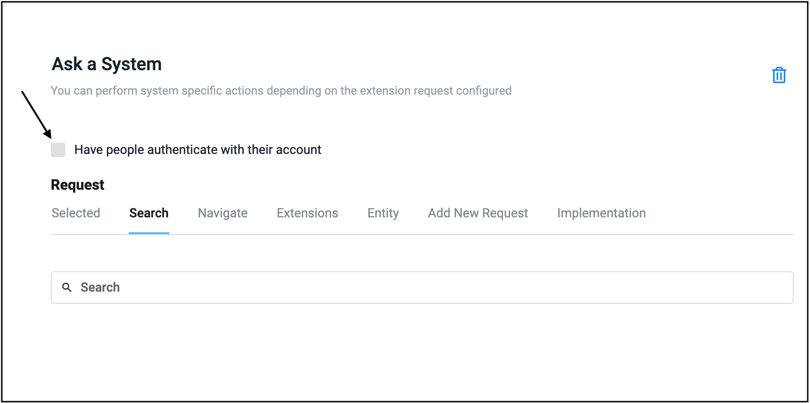

[< Back](README.md)

# Authentication

## Service Account Authentication

- If the **Have people authenticate with their accounts** checkbox is **unchecked** in the **Ask a System** step of a Conversation, the system will use the service account to run the conversation.
- The service account is configured and validated during the extension setup process.
- This approach allows automated actions without requiring individual user credentials.

  

## User Account Authentication

- If the **Have people authenticate with their accounts** checkbox is **checked** in the **Ask a System** step of a Conversation, each user must authenticate with their own account before the conversation can proceed.
- This ensures that actions are performed on behalf of the authenticated user, providing user-level security and auditability.

  
