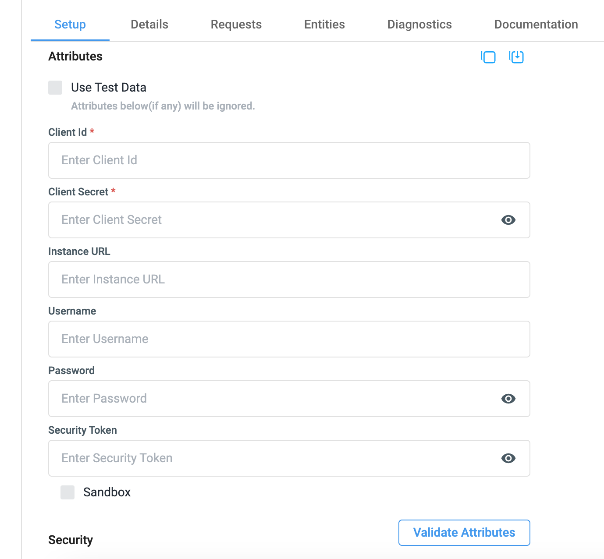

[< Back](README.md)

# Connecting Krista Salesforce Customer Service Module Extension

### Steps for connection

To set up the connection, you need to provide **Client ID** and **Client Secret** (obtained from the Salesforce portal). Depending on your authentication method, you may also need **Username**, **Password**, and **Security Token**. Optionally, you can provide the **Instance URL** and set the **Sandbox** flag if you are connecting to a Salesforce Sandbox.

* Configure the following attributes for the Salesforce Customer Service Extension:
    * For **Client ID** and **Client Secret**, refer to the **Manage Consumer Details** section from your Connected App in Salesforce.

  
    * For **Username** and **Password**, use your Salesforce login credentials.
    * For **Security Token**, use the security token that you received via email after resetting it in your Salesforce org.
    * For **Instance URL** (optional), use your Salesforce domain base URL (for example, https://mydomain.my.salesforce.com). If left blank, the extension will determine it automatically during OAuth.
    * **Sandbox** (optional): Enable this if connecting to a Salesforce Sandbox; leave disabled for Production.

### Authentication flows used by this extension

- If you provide an Instance URL, the extension uses OAuth 2.0 Client Credentials to obtain a token for a designated integration user.
  - Prerequisites in Salesforce Connected App (Manage → Edit Policies): Enable “OAuth 2.0 Client Credentials Flow” and set “Run As” to your Integration User.
  - Instance URL must be your org base domain, for example: https://your-domain.my.salesforce.com
    - Do not use the Lightning domain (…lightning.force.com)
    - Do not include a trailing slash
- If you leave Instance URL blank, the extension guides you through user authorization and stores a refresh token (standard OAuth authorization code flow).
- OAuth 2.0 Password Grant (Username/Password + Security Token) is used as a fallback when other OAuth flows are not configured.

* After you have provided the required credentials (Client ID, Client Secret, and any additional fields based on your authentication method), click **Validate Attributes**.

* Once you click **Validate Attributes**, an authentication page may appear (for OAuth flows). Click on that tab and authorize yourself using the same account that was used to register your Connected App in Salesforce.

* After you are authorized, click on **Save Changes**.

* Now navigate to **Diagnostics** and click **Test Connection** to confirm that the connection is established. When the connection is successful, you can proceed with using the extension's requests.
