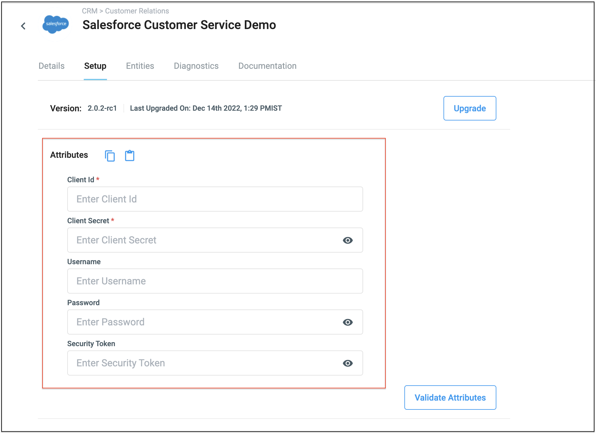
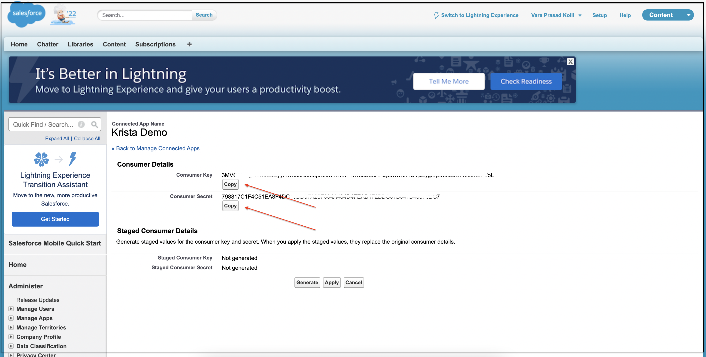

[< Back](/)

# Connecting Krista Salesforce Customer Service Module Extension

### Steps for connection

To set up the connection, you must provide the **Client ID**, **Client Secret**, **Username**, **Password**, and **Security Token** in the extension setup which obtained from Salesforce Portal.

* Refer to the following tabs for Salesforce Customer Service Extension Attributes.
    * For **Client ID** and **Client Secret**, refer to the **Manage Consumer Details** tab from your registered web application in Salesforce Portal.

  
    * For **Username** and **Password**, you can use salesforce login credentials as **username** and **password**.
    * For **Security Token**, you must use the Security Token that you received on your registered email after you reset it on Salesforce system.

* After you have provided the username, password, client id, client secret, and security token , click on the **Validate Attributes**.

* Once you click on validate , an authentication page will appear. Click on that tab and authorize yourself using the same account which is used to register your application in Salesforce Portal.

* After you are authorized, click on **Save Changes**.

* Now navigate to Diagnosis and click on **Test Connection** to confirm that the connection is established. When the connection is established, you are good to go with the requests of the extension.
