[< Back](/)

# Salesforce Authentication Guide

This guide covers how the Krista Salesforce Customer Service Extension automatically determines which authentication method to use based on the parameters you provide. The extension supports three authentication flows and will automatically select the appropriate one:

## How Authentication Method is Determined

The extension automatically chooses the authentication method based on what you configure:

1. **OAuth 2.0 Client Credentials Flow** - Used when you provide `Instance URL` + `Client ID` + `Client Secret`
2. **OAuth 2.0 Authorization Code Flow** - Used when you provide only `Client ID` + `Client Secret` (Instance URL left blank)
3. **OAuth 2.0 Password Grant Flow** - Used when OAuth is not configured (requires `Client ID` + `Client Secret` + `Username` + `Password` + `Security Token`)

> **Important**: You don't select an "authentication method" - the extension automatically determines which flow to use based on the parameters you provide.

## Quick Reference: Parameter Combinations

| Parameters Provided                                                          | Authentication Method Used     | Use Case                                  |
|------------------------------------------------------------------------------|--------------------------------|-------------------------------------------|
| `Client ID` + `Client Secret` + `Instance URL`                               | **Client Credentials Flow**    | Server-to-server, no user interaction     |
| `Client ID` + `Client Secret` (Instance URL blank)                           | **Authorization Code Flow**    | User interactive, web-based               |
| `Client ID` + `Client Secret` + `Username` + `Password` + `Security Token`   | **Password Grant Flow**        | When OAuth not configured                 |

---

### Important Notes for Setup and Testing

> **After Configuration**: Once you've provided the required credentials (Client ID, Client Secret, and any additional fields based on your authentication method), click **Validate Attributes**.

> **Authorization Process**: When you click **Validate Attributes**, an authentication page may appear (for OAuth flows). Click on that tab and authorize yourself using the same account that was used to register your Connected App in Salesforce.

> **Save and Test**: After authorization, click **Save Changes**. Then navigate to **Diagnostics** and click **Test Connection** to confirm the connection is established. When successful, you can proceed with using the extension's requests.

> **Instance URL Requirements**:
> - Must be your org base domain (e.g., `https://your-domain.my.salesforce.com`)
> - Do NOT use Lightning domain (`...lightning.force.com`)
> - Do NOT include a trailing slash

> **Client Credentials Prerequisites**: For Client Credentials Flow, ensure your Salesforce Connected App has "OAuth 2.0 Client Credentials Flow" enabled and "Run As" set to your Integration User (Manage → Edit Policies).

---

## 1. OAuth 2.0 Authorization Code Flow

> **When used**: When you provide only `Client ID` + `Client Secret` (Instance URL left blank)
> **Required parameters**: `Client ID` + `Client Secret` (Instance URL must be blank)
> **Best for**: User-interactive applications and web-based integrations

### Overview
The OAuth 2.0 Authorization Code Flow is the standard OAuth flow that redirects users to Salesforce for authentication. Users log in through Salesforce's secure interface, and the extension receives an authorization code that's exchanged for access tokens.

### Prerequisites
- A Salesforce Developer Account or admin access to your Salesforce org
- Access to create Connected Apps in Salesforce
- The Krista extension's callback URL

### Step 1: Create a Connected App
* Go to the Salesforce login page from [here](https://login.salesforce.com/).
* Navigate to the Setup icon and click **Setup**.
  
* On the SETUP Home page, under the **Apps** menu on the left panel, click **App Manager**.
  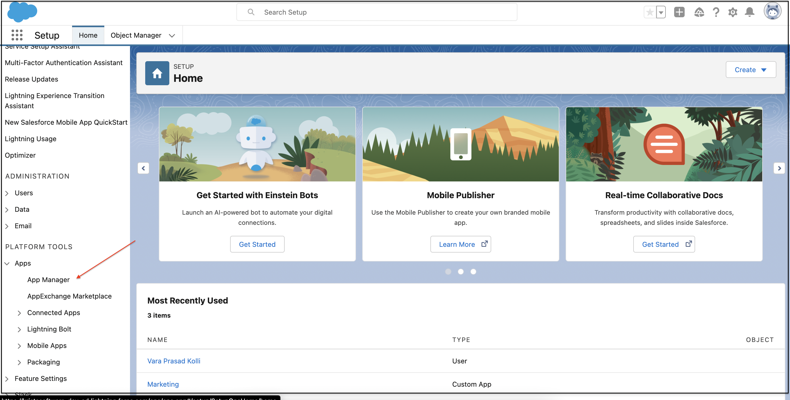
* On the Lightning Experience App Manager, click **New Connected App**.
  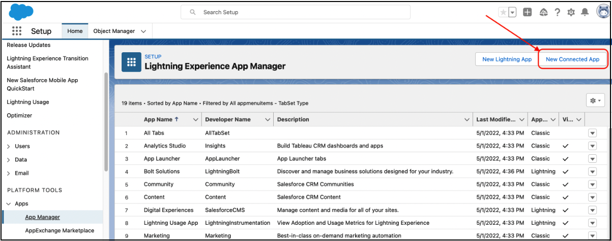

### Step 2: Configure Basic Information
* On the App creation page, in the Basic Information panel, enter:
  * **Connected App Name**: Your app name (e.g., "Krista Salesforce Integration")
  * **API Name**: Auto-generated from the app name
  * **Contact Email**: Your email address
  * **Description** (optional): Description of your integration
  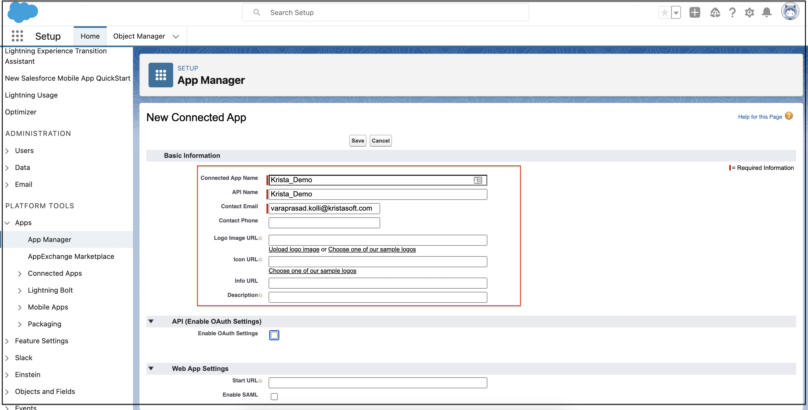

### Step 3: Configure OAuth Settings
* In the API (Enable OAuth Settings) panel, select the **Enable OAuth Settings** checkbox.
* **Callback URL Configuration**:
  * Go to the Details tab in your Krista Salesforce Customer Service Extension
  * Copy the **Extension Base URL**
  * Append `/rest/salesforcecustomerservice/callback` to create your redirect URI
  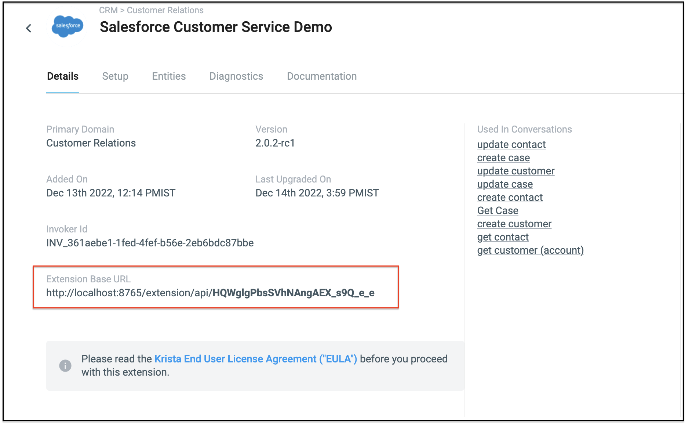
  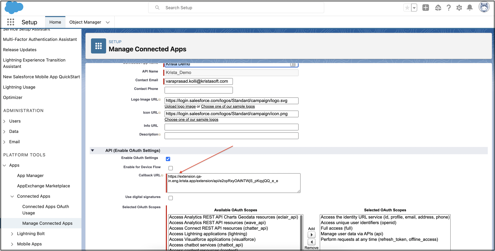

### Step 4: Configure OAuth Scopes
* In **Selected OAuth Scopes**, add the following scopes:
  * **Access Analytics REST API Charts Geodata resources** (eclair_api)
  * **Access Analytics REST API resources** (wave_api)
  * **Access Chatter API resources** (chatter_api)
  * **Access Visualforce applications** (visualforce)
  * **Access custom permissions** (custom_permissions)
  * **Access the identity URL service** (id, profile, email, address, phone)
  * **Access unique user identifiers** (openid)
  * **Full access** (full)
  * **Manage user data via APIs** (api)
  * **Manage user data via Web browsers** (web)
  * **Perform requests at any time** (refresh_token, offline_access)

### Step 5: Configure Security Settings
* Select the **Require Secret for Web Server Flow** checkbox.
* Select the **Require Secret for Refresh Token Flow** checkbox.
  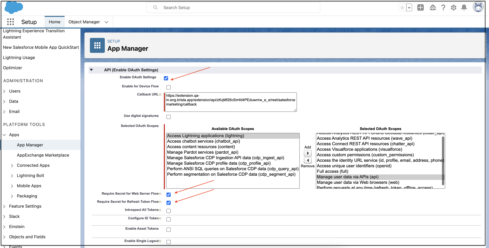
* Click **Save** and then **Continue**.

### Step 6: Obtain Client Credentials
* On the App info page, under API (Enable OAuth Settings), click **Manage Consumer Details**.
* Copy the **Consumer Key** (this is your **Client ID**)
* Copy the **Consumer Secret** (this is your **Client Secret**)
  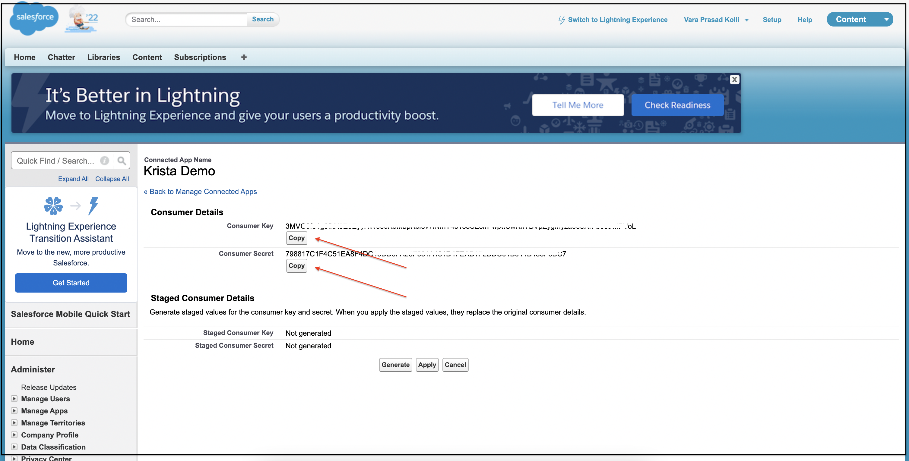

### Step 7: Configure App Policies
* Go back to the App info page and click **Manage**, then **Edit Policies**.
* Under OAuth Policies:
  * Change **Permitted Users** to "All users may self-authorize"
  * Set **Refresh Token Policy** to "Refresh token is valid until revoked"
  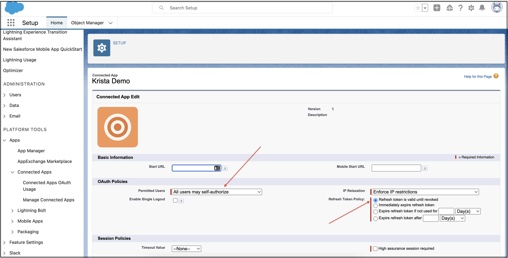
* Click **Save**.

### Step 8: Configure Extension
When setting up the extension for Authorization Code Flow:
1. **Client ID**: Enter the Consumer Key from step 6
2. **Client Secret**: Enter the Consumer Secret from step 6
3. **Instance URL**: **Leave blank** (this is critical - blank Instance URL triggers Authorization Code Flow)
4. **Username**: Leave blank (not needed for OAuth flows)
5. **Password**: Leave blank (not needed for OAuth flows)
6. **Security Token**: Leave blank (not needed for OAuth flows)
7. **Sandbox**: Check if connecting to a sandbox org

### Steps for connection
To set up the connection, you need to provide **Client ID** and **Client Secret** (obtained from the Salesforce portal) and set the **Sandbox** flag if you are connecting to a Salesforce Sandbox.
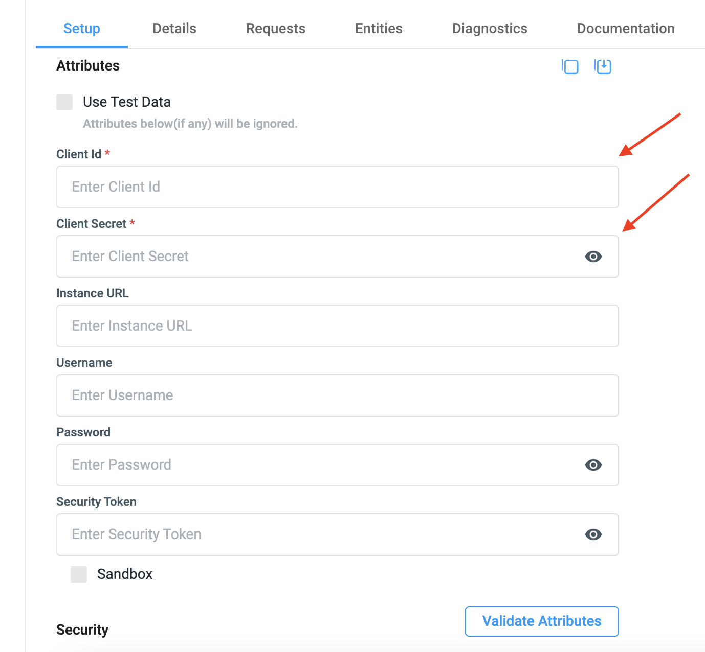

> **Critical**: Instance URL must be left blank to trigger Authorization Code Flow. If you provide an Instance URL, the extension will use Client Credentials Flow instead.

### Authentication Process
1. User initiates a Salesforce operation in the extension
2. Extension redirects user to Salesforce login page
3. User authenticates with Salesforce credentials
4. Salesforce redirects back to extension with authorization code
5. Extension exchanges code for access and refresh tokens
6. Extension uses access token for API calls
7. Extension automatically refreshes tokens when they expire

### Security Benefits
- **User Credentials Never Stored**: Extension never sees user passwords
- **Fine-Grained Permissions**: Scopes limit what the extension can access
- **Token Expiration**: Access tokens expire automatically for security
- **Revocable Access**: Users can revoke access at any time
- **Audit Trail**: All API access is logged in Salesforce

---

## 2. OAuth 2.0 Client Credentials Flow

> **When used**: When you provide `Instance URL` + `Client ID` + `Client Secret`
> **Required parameters**: `Client ID` + `Client Secret` + `Instance URL`
> **Best for**: Server-to-server integrations where no user interaction is required

### Overview
The OAuth 2.0 Client Credentials Flow enables direct server-to-server authentication without user interaction. The extension authenticates using only Client ID and Client Secret, making it perfect for automated background processes.

### Prerequisites
- A Salesforce Developer Account or admin access to your Salesforce org
- Access to create Connected Apps in Salesforce
- A dedicated integration user account (recommended)

### Step 1: Create a Connected App
* Follow the same steps as in the Authorization Code Flow to create a Connected App
* Go to **Setup** → **App Manager** → **New Connected App**
  
  
  

### Step 2: Configure Basic Information
* Enter your app details:
  * **Connected App Name**: "Krista Salesforce Service Integration"
  * **API Name**: Auto-generated
  * **Contact Email**: Your email address
  * **Description**: "Server-to-server integration for automated processes"
  

### Step 3: Configure OAuth Settings
* Select **Enable OAuth Settings** checkbox
* **Callback URL**: Use a placeholder like `https://localhost/callback`
* **Critical Step**: Check **Enable OAuth 2.0 Client Credentials Flow**
* Select **Require Secret for Web Server Flow** and **Require Secret for Refresh Token Flow**
  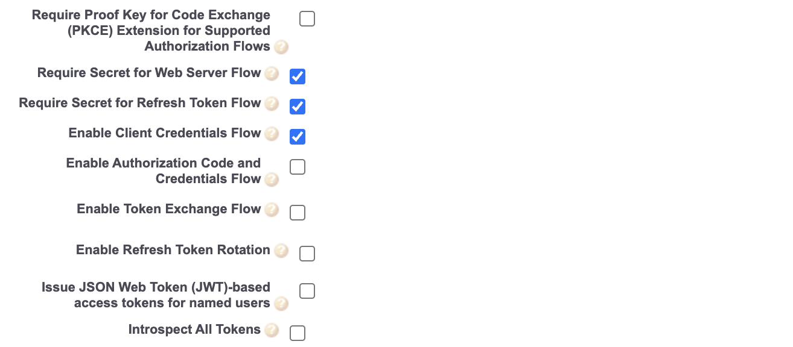

### Step 4: Configure OAuth Scopes
* Add required scopes:
  * **Manage user data via APIs** (api) - Essential for API access
  * **Access custom permissions** (custom_permissions) - If using custom permissions
  * **Full access** (full) - For comprehensive access (use carefully)

### Step 5: Obtain Client Credentials
* Click **Save** and **Continue**
* Click **Manage Consumer Details** to get:
  * **Consumer Key** (Client ID)
  * **Consumer Secret** (Client Secret)
  

### Step 6: Configure Client Credentials Policies
* Go to **Manage** → **Edit Policies**
* In the **OAuth 2.0 Client Credentials Flow** section:
  * **Enable OAuth 2.0 Client Credentials Flow**: ✓ Checked
  * **Principal**: Select "Named Principal (Run As)"
  * **Run As User**: Select your integration user account
  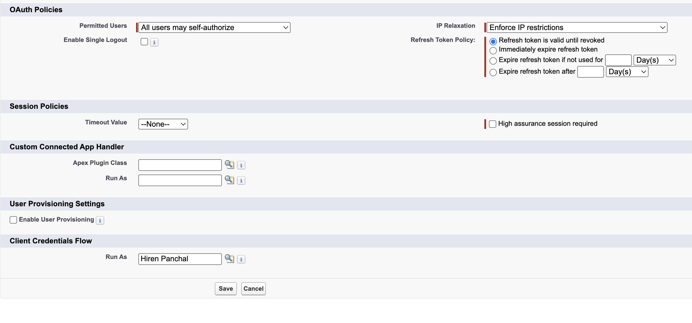
* Click **Save** and wait 2-5 minutes for changes to propagate

### Step 7: Configure Extension

> **Note**: The extension supports optional Instance URL and Sandbox settings. If your org requires a specific domain, you may set Instance URL to your Salesforce base domain (for example, https://mydomain.my.salesforce.com). Use the Sandbox flag if you are connecting to a sandbox org.

### Steps for connection
To set up the connection, you need to provide **Client ID** , **Client Secret** (obtained from the Salesforce portal) and **Instance URL**  and set the **Sandbox** flag if you are connecting to a Salesforce Sandbox.
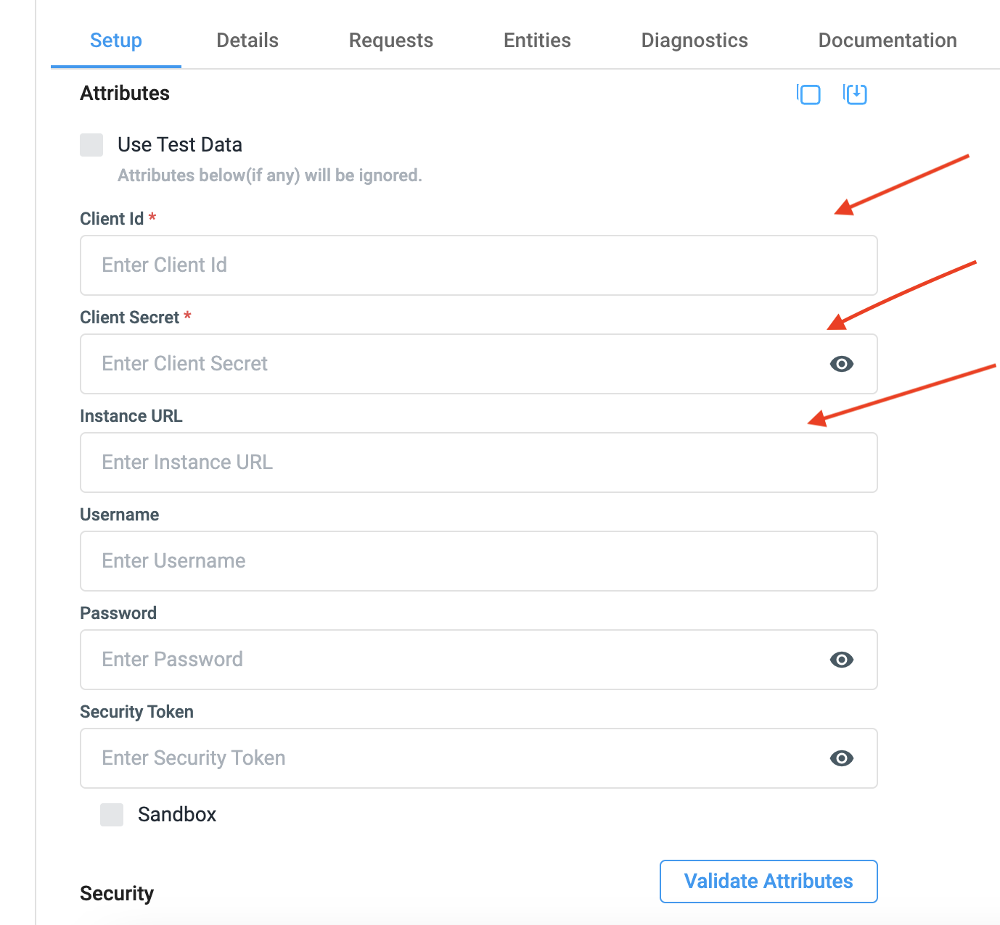

---

## 3. OAuth 2.0 Password Grant Flow

> **When used**: When OAuth is not configured
> **Required parameters**: `Username` + `Password` + `Security Token` + `Client ID` + `Client Secret`
> **Best for**: Development, testing, and simple integrations
> **Best for**: Development, testing, and simple integrations

### Overview
The OAuth 2.0 Password Grant Flow uses your Salesforce username, password, and security token to authenticate via OAuth 2.0. This method is straightforward but requires storing credentials directly in the extension configuration.

### Prerequisites
- A Salesforce Developer Account or regular Salesforce account
- Access to your Salesforce org's setup area
- Email access to receive the security token

### Step 1: Obtaining Username and Password

#### If you already have a Salesforce account:
* Use your existing Salesforce username and password

#### If you need a new Salesforce Developer Account:
* Go to the Salesforce Developer portal from [here](https://developer.salesforce.com/).
* Click the **Sign Up** button. Enter all personal details and click **Sign Me Up**.
* Check the verification email in your Inbox and click **Verify Account**.
  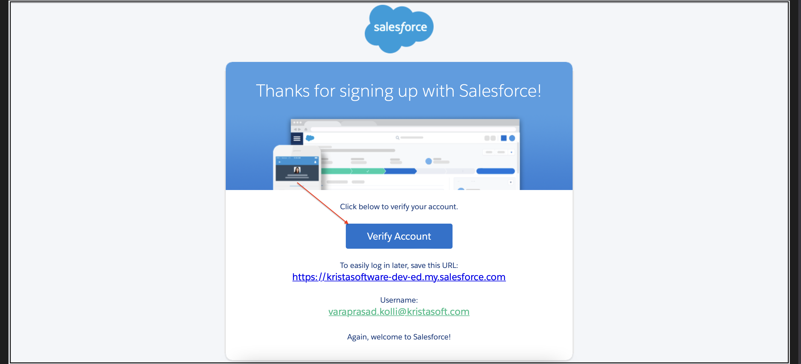
* You will be redirected to the **Change Your Password** page. Set up a new password and configure your **Security Question** and **Answer**.
  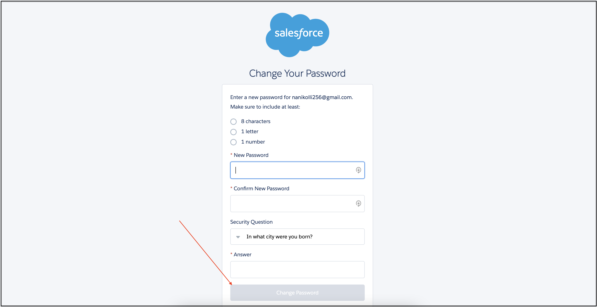
* Click **Change Password**. Save these credentials as your **Username** and **Password**.

### Step 2: Obtaining Security Token
* Log in to your Salesforce account and navigate to your user profile. Click **Settings**.
  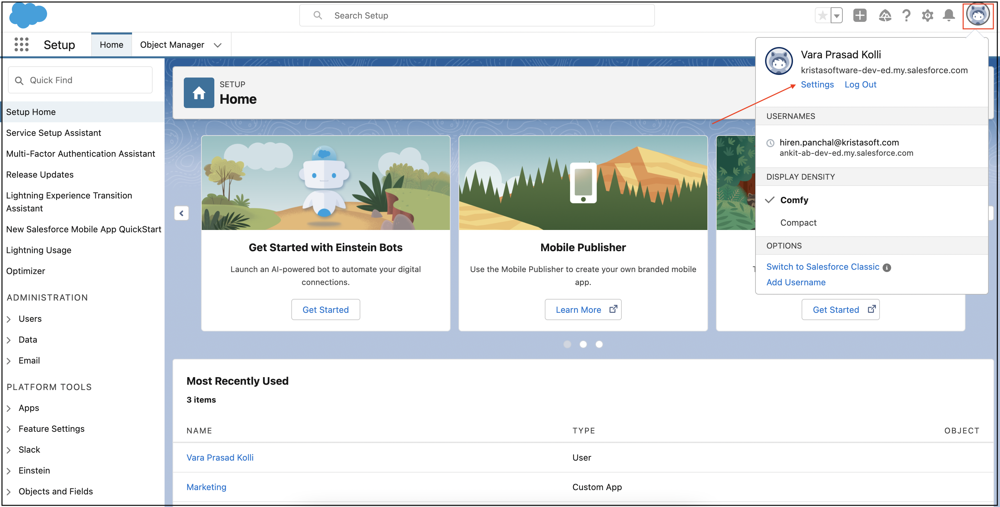
* On the navigation panel, click **Reset My Security Token** and then **Reset Security Token**.
  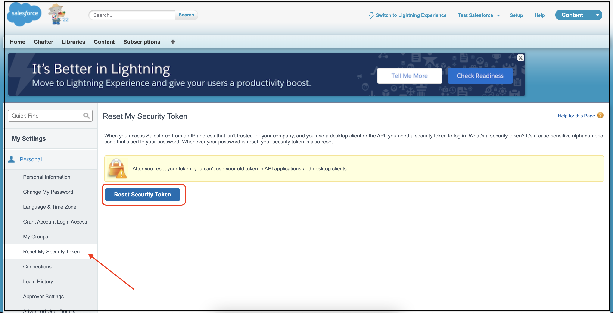
* You will receive a unique security token via email. Save this token for the extension setup.

### Step 3: Enable Username-Password Flow (if needed)
* Navigate to the Setup icon and click **Setup**.
  
* From the left navigation panel under **SETTINGS**, click on the **Identity** dropdown.
  * Click **OAuth and OpenID Connect Settings**.
  * Enable the **Allow OAuth Username-Password Flows** toggle switch.
    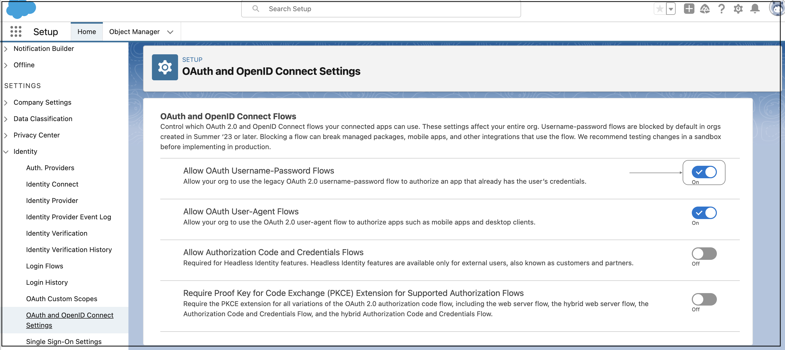

### Step 4: Configure Extension
When setting up the extension for Password Grant Flow:
1. **Client ID**: Enter your Connected App's Consumer Key
2. **Client Secret**: Enter your Connected App's Consumer Secret
3. **Username**: Enter your Salesforce username
4. **Password**: Enter your Salesforce password
5. **Security Token**: Enter the security token received via email
6. **Instance URL**: Leave blank (this triggers Authorization Code Flow if OAuth is configured)
7. **Sandbox**: Check if connecting to a sandbox org

### Steps for connection
To set up the connection, you need to provide **Client ID** and **Client Secret** (obtained from the Salesforce portal). Depending on your authentication method, you also need **Username**, **Password**, and **Security Token** and set the **Sandbox** flag if you are connecting to a Salesforce Sandbox.
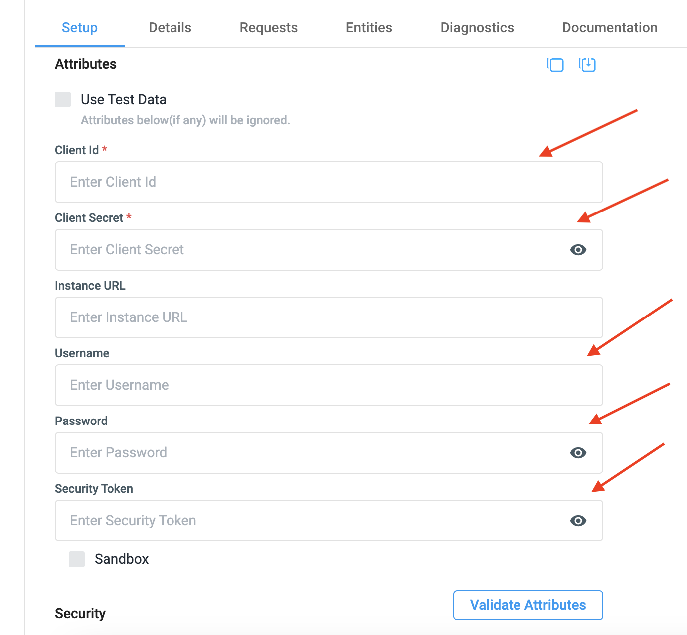

> **Note** : 
> 1. For **Username** and **Password**, use your Salesforce login credentials.
> 2. For **Security Token**, use the security token that you received via email after resetting it in your Salesforce org.

### Security Considerations
- **Less Secure**: Credentials are stored in the extension configuration
- **No Token Expiration**: Unlike OAuth tokens, these credentials don't automatically expire
- **Limited Scope**: Cannot restrict access to specific resources
- **Recommended Use**: Development, testing, or simple integrations only

---

### When setting up the extension for Client Credentials Flow:
1. **Client ID**: Enter the Consumer Key
2. **Client Secret**: Enter the Consumer Secret
3. **Instance URL**: **Must provide** your Salesforce org domain (e.g., https://your-domain.my.salesforce.com)
   - **Critical**: Providing Instance URL triggers Client Credentials Flow
   - Use your org domain, not lightning.force.com URLs
   - Do not include a trailing slash
4. **Username**: Leave blank (not needed for Client Credentials Flow)
5. **Password**: Leave blank (not needed for Client Credentials Flow)
6. **Security Token**: Leave blank (not needed for Client Credentials Flow)
7. **Sandbox**: Check if connecting to a sandbox org

### Authentication Process
1. Extension makes a direct API call to Salesforce token endpoint
2. Salesforce validates Client ID and Client Secret
3. Salesforce returns an access token
4. Extension uses access token for all API calls
5. Extension requests new tokens when they expire

### Security Benefits
- **No User Interaction**: Perfect for automated processes
- **Controlled Access**: Runs as a specific user with defined permissions
- **Simple Credentials**: Only Client ID and Secret needed
- **Audit Trail**: All actions logged under the "Run As" user