[< Back](README.md)

# Obtaining User and OAuth2.0 Credentials

> Note: The extension supports optional Instance URL and Sandbox settings. If your org requires a specific domain, you may set Instance URL to your Salesforce base domain (for example, https://mydomain.my.salesforce.com). Use the Sandbox flag if you are connecting to a sandbox org.

### Obtaining Username, Password, and Security Token

* If you already have a Salesforce Developer Account, use the pre-existing user credentials as Username and Password.

* If you don’t have a pre-existing account, sign up for a new Salesforce Developer Account.

* Go to Service account page of salesforce portal from [here](https://developer.salesforce.com/).

* Now click **Sign Up** button. A new page will appear. Enter all the personal details and click **Sign Me Up**.

* Ensure that you check the verification email in your Inbox. Click **Verify Account**.
  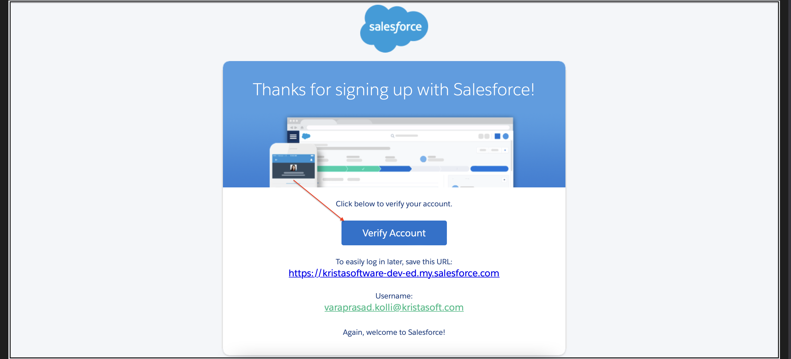

* You will be redirected to the **Change Your Password** page on the Salesforce system. Set up the new password following the guidelines. Also, configure the **Security Question** and **Answer**.
  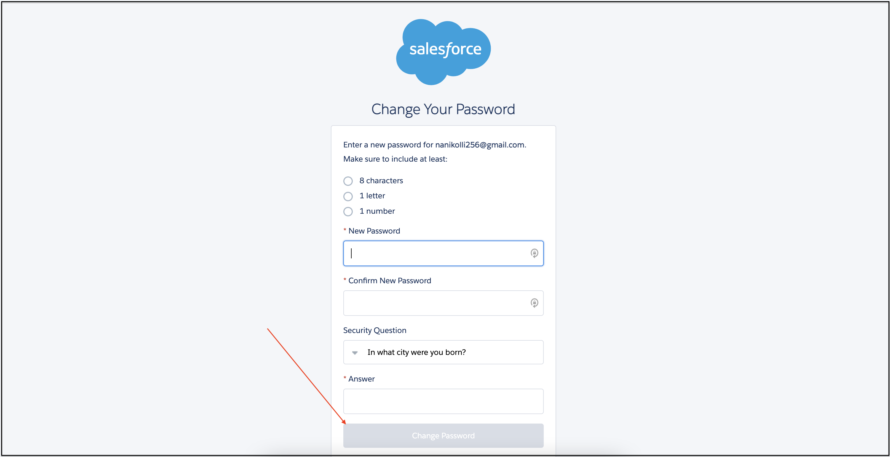

* Click **Change Password**. Save these user credentials to use from now onward as **Username** and **Password** for Krista Salesforce Customer Service extension setup.

* Log in to your Salesforce contact. Navigate to user profile and click **Settings**.
  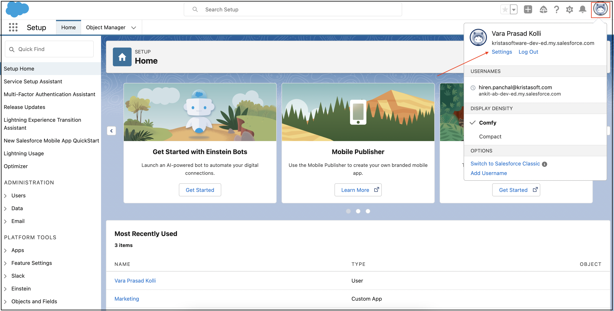

* On the navigation panel, click **Reset My Security Token** and **Reset Security Token**. You will receive unique security token ID on your registered email. Save this security token to use from now onward as **Security Token** on Krista Salesforce Customer Service extension setup.
  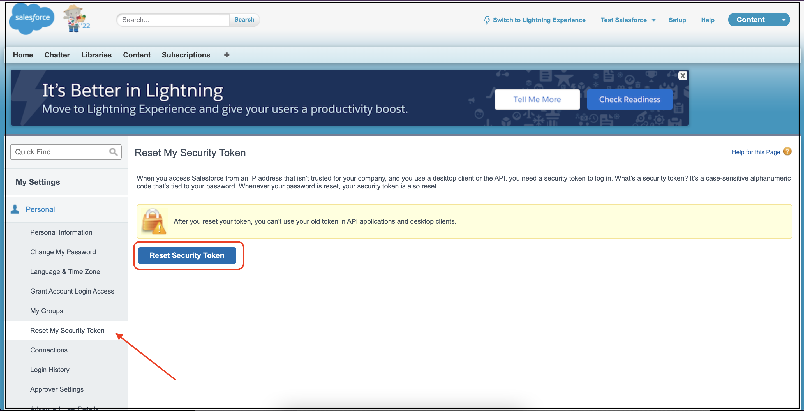

### Obtaining Client ID and Client Secret for OAuth2.0

* Go to the login page of the salesforce portal from [ here](https://login.salesforce.com/).

* Navigate to the Setup icon and then click **Setup**.
  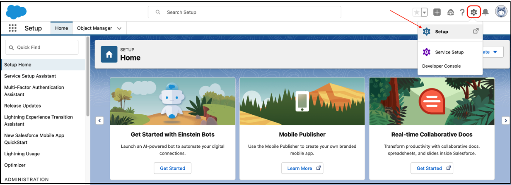

* On the SETUP Home page, under the **Apps** menu on the left panel, click **App Manager**.
  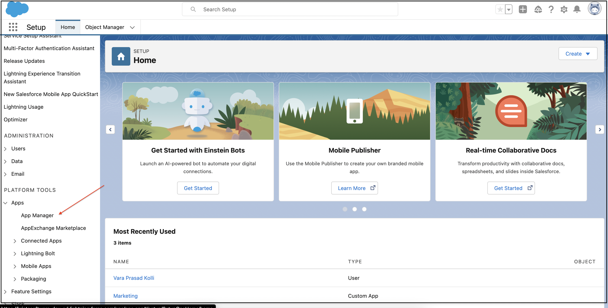

* On the SETUP Lightening Experience App Manager, click **New Connected App**.
  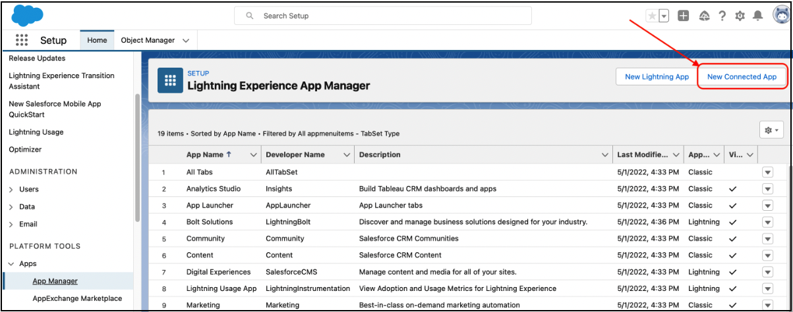

* On the App creation page, in the Basic Information panel, enter the details for the **Connected App Name**, **API Name**, and **Contact Email** fields as per your requirement. These are mandatory fields. If you want, you can set up additional fields such as **Logo Image URL**, **Icon URL**, **Info Url**, and **Description**.
  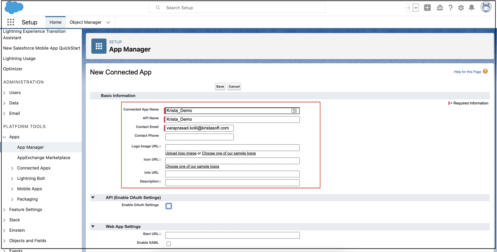

* In the API (Enable OAuth Settings) panel, select the **Enable OAuth Settings** checkbox.

* Enter the **Callback URL** details corresponding to your extension.
  * Goto Details tab in the Krista Salesforce Customer Service Extension and copy **Extension Base URL** from there. After that append **'rest/salesforcecustomerservice/callback'** at the end of the URL.(This is your redirect URI).
  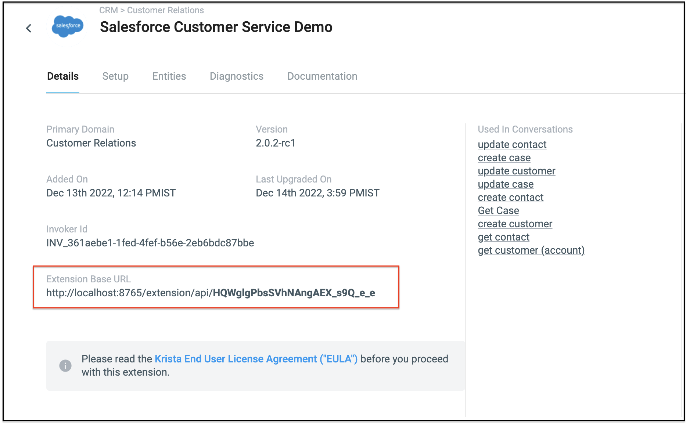
  * Enter the **Callback URL** details.
  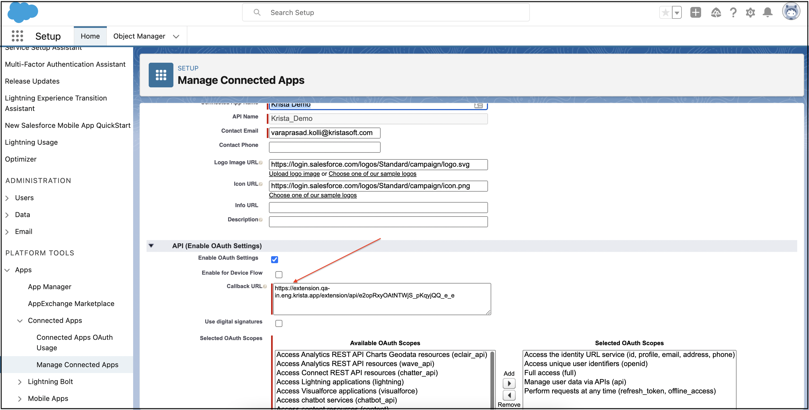

* In **Selected OAuth Scopes**, add the following scope entries:
  * Access Analytics REST API Charts Geodata resources (eclair_api)
  * Access Analytics REST API resources (wave_api)
  * Access Analytics REST API resources (chatter_api)
  * Access Visualforce applications (visualforce)
  * Access custom permissions (custom_permissions)
  * Access the identity URL service (id, profile, email, address, phone)
  * Access unique user identifiers (openid)
  * Full access (full)
  * Manage user data via APIs (api)
  * Manage user data via Web browsers (web)
  * Perform requests at any time (refresh_token, offline_access)

* Select the **Require Secret for Web Server Flow** checkbox.

* Select the **Require Secret for Refresh Token Flow** checkbox.
  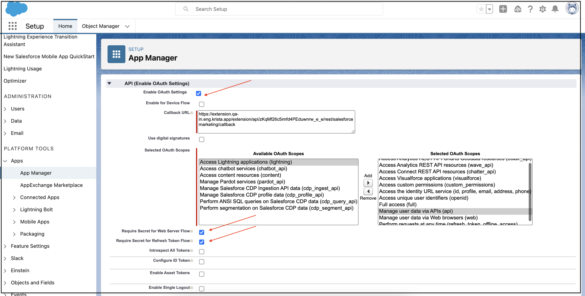

* Click **Save** and then Click on **Continue**.
* Now you will land in the App info Page. Under API (Enable OAuth Settings) Click on **Manage Consumer Details**.
* Copy the **Consumer Key**, this will be the Client ID and copy the **Consumer Secret**, this will be **Client Secret**. Save this **Client Id** and **Client Secret** which are needed for Krista Salesforce Customer Service Extension setup.
  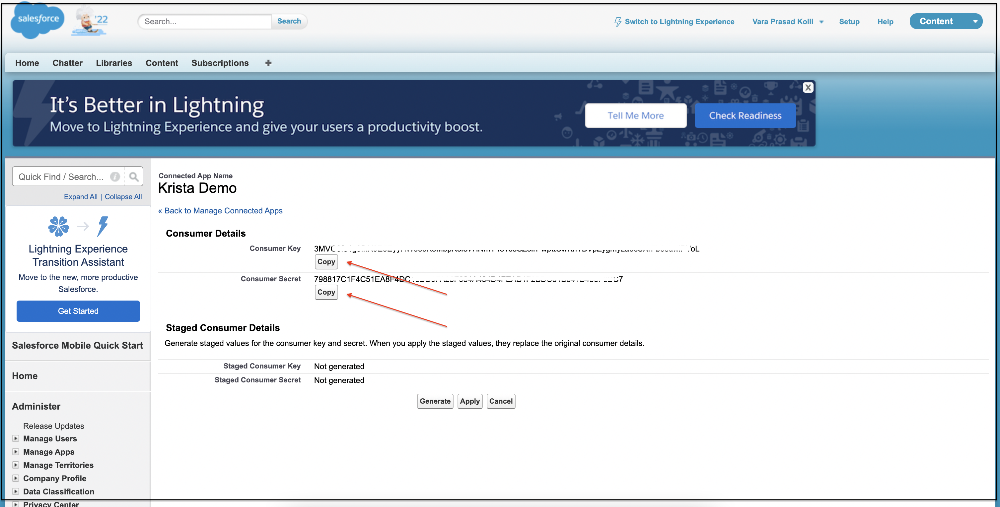

* Go back to App info page and Click on **Manage** and then Click on **Edit Policies**.
* Under OAuth Policies:
  * Change Permitted Users to **All users may self-authorize**.
  * Select Refresh Token Policy as **Refresh token is valid until revoked**.
    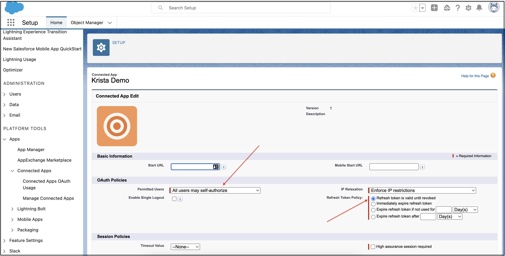

* Click **Save**.

### Enabling OAuth 2.0 Client Credentials (optional, for server-to-server)

If you plan to use the Client Credentials flow (no user prompt), configure the Connected App Policies:

1. In App Manager, open your Connected App → Manage → Edit Policies
2. In the “OAuth 2.0 Client Credentials Flow” section:
   - Check “Enable OAuth 2.0 Client Credentials Flow”
   - Set Principal to “Named Principal (Run As)” and select your Integration User
3. Save and wait 2–5 minutes for changes to propagate

   Example: API (Enable OAuth Settings) with “Enable Client Credentials Flow” selected

   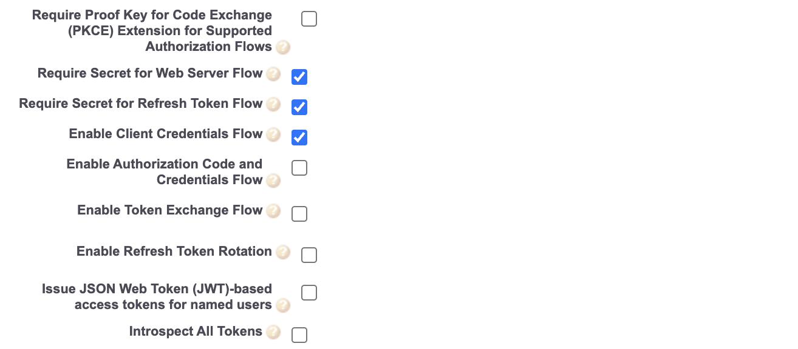

4. Use your org domain as the Instance URL in the extension, for example: https://your-domain.my.salesforce.com
   - Do not use https://…lightning.force.com
   - Do not include a trailing slash

With this configured, when you set Instance URL in the extension, it will request tokens using client_credentials and act as the selected Run As user.
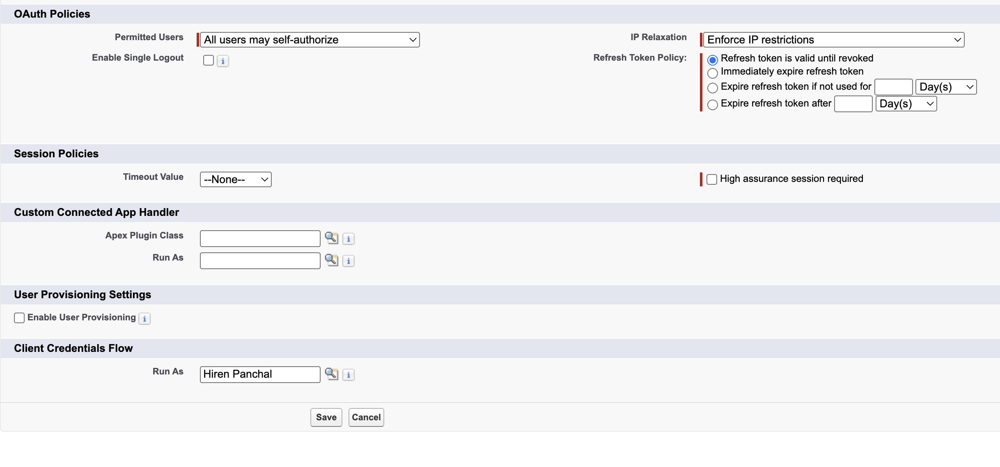

* Provide the values of Client ID and Client Secret in your Salesforce Customer Service Extension setup page and proceed with the Extension request.

* If you want to use the Basic Authentication Flow for authentication then follow the following steps:

* Navigate to the Setup icon and then click **Setup**.
  

* From the left navigation panel under **SETTINGS** section click on **Identity** drop down.
  * Click **OAuth and OpenID Connect Settings**.
  * To enable the Basic Authentication Flow, use the **Allow OAuth Username-Password Flows** toggle switch.
    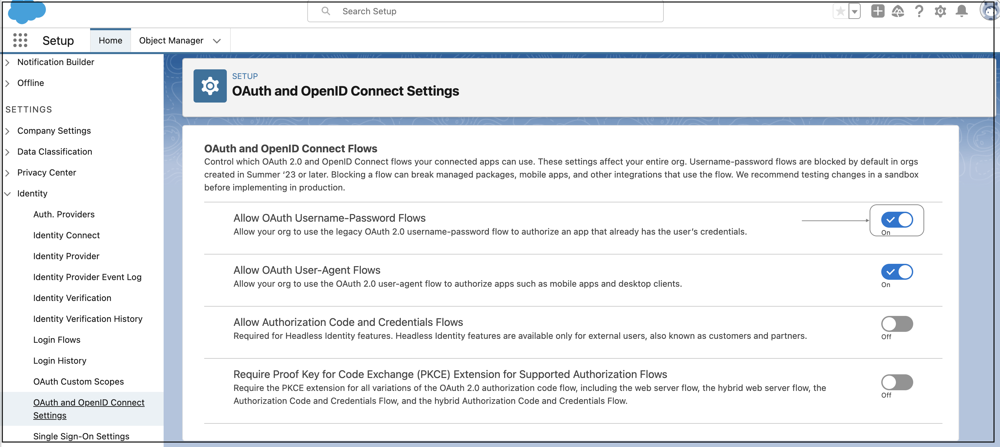

