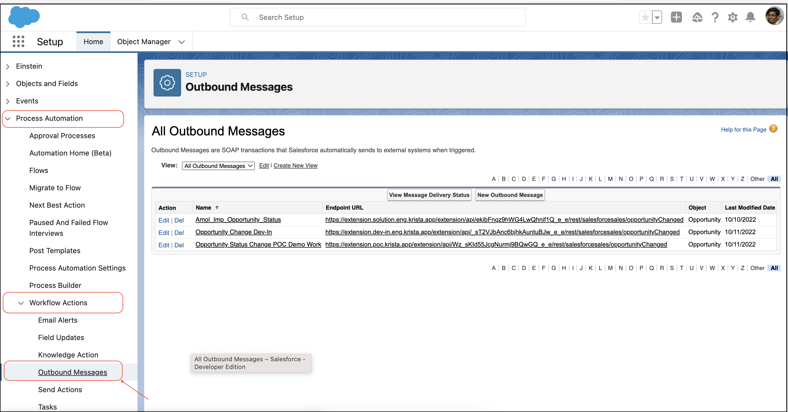
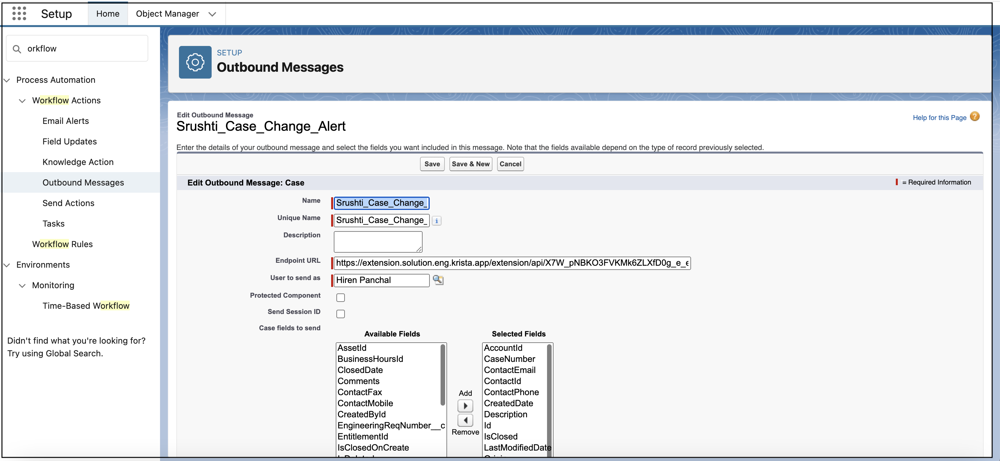
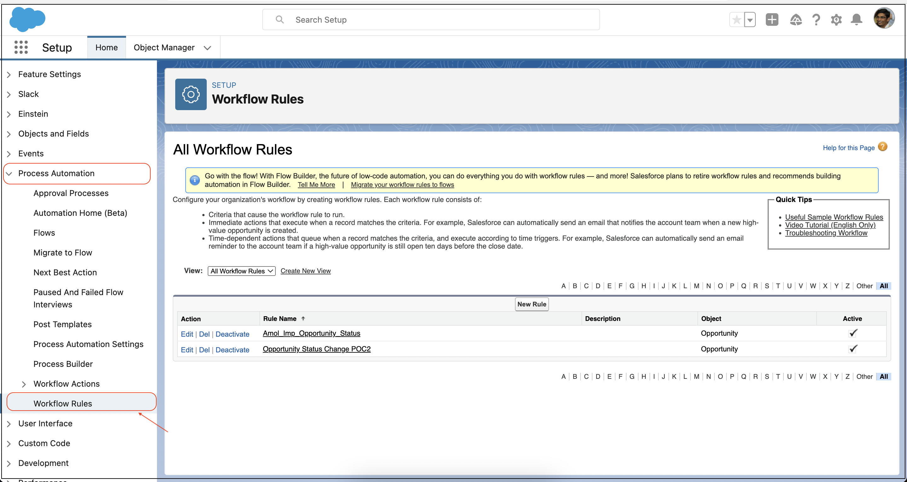
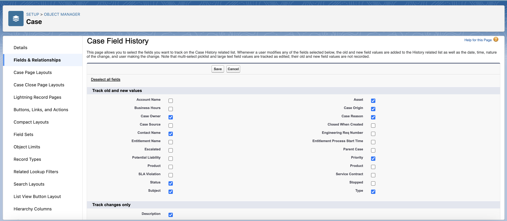
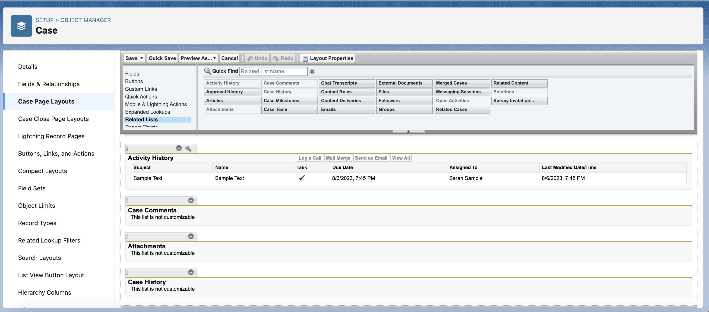

[< Back](/)

# Supported Requests

## Catalog Requests

Krista Salesforce Customer Service Module Extension supports the following Catalog Requests:

### Case Management Area

* Get Case Feed Items By Case Id
    * Description: This request will fetch the list of post items for the given Case Id.
    * Input Parameters:

| **Parameter Name** | **Parameter Type** | **Mandatory** | **Example**        |
|--------------------|--------------------|---------------|--------------------|
| Case Id            | Text               | Yes           | 0065w00002AlDtDAAM |

* Output:

| **Parameter Name** | **Parameter Type**   |
|--------------------|----------------------|
| Feed Items         | List&lt;Multi Field> |

* Share Update to Case
    * Description: This request will add update to the Feed of the Case for the given Case Id.
    * Input Parameters:

| **Parameter Name** | **Parameter Type** | **Mandatory** | **Example**          |
|--------------------|--------------------|---------------|----------------------|
| Case Id            | Text               | Yes           | 0065w00002AlDtDAAM   |
| Update Message     | Paragraph          | Yes           | Message to be posted |

* Output:

| **Parameter Name** | **Parameter Type** |
|--------------------|--------------------|
| Is Updated         | Boolean            |

#### Case Change Alert

- **Description**: This request is for the changes(creation and update) in the case.
- **Input Parameters**: No Parameters Required

- **Output Parameters**:

| **Parameter Name** | **Parameter Type** |
|--------------------|--------------------|
| Response           | MultiField         |

**Steps To Create Alert In Salesforce Customer Service**

- Navigate to the Setup icon and then click **Setup**.
  

- On the SETUP Home page, under the **Process Automation** menu on the left panel, under the **Workflow Actions**,
  click **Outbound Messages**.
  

- On the **Outbound Messages** page, click **New Outbound Message**.

  - Select **Case** object and then click **Next**.

  - On the next page enter **Name**.

  - Enter **Endpoint URL**
    - Go to the Detail's page of the extension and copy the Routing id from there. After that, append **'
      /rest/salesforcecustomerservice/caseChanged'** at the end of the routing id (This is your endpoint url).

      

  - Select Case fields from case entity list to send and then click **Save**.

    

  - Now create **Workflow Rule**.

  - On the SETUP Home page, under the **Process Automation** menu on the left panel, click **Workflow Rules**.
    

  - On the **Workflow Rules**, click **New Rule** and select **Continue with Workflow Rules**.

  - On the Workflow Rules page, From the Object drop-down list, select **Case** as an object then click **Next**.

  - On the next page add **Rule Name**, **Evaluation Criteria**, and **Rule Criteria** and then click **Save & Next**.

  - On the next page click **Add Workflow Action** and select **Select Existing Action**.

  - On the next page select **Outbound Message** under the **Choose Action Type**.

  - And select your created Outbound Message under **Available Actions** and click Add arrow, and then click **Save**.

  - Now click **Done** button.

* For the purpose of tracking history of attribute values, perform the following steps:
  - Click Setup icon on the upper right of the salesforce page.
  - Select object manager on the left upper navigation bar.
  - Select Case if you are working with case change alert  as the LABEL.
  - Select Fields and Relationships from the left menu.
  - Click **Set History Tracking** on the upper right and enable Case History.
  - Select the below given fields and save.
    

  - Select Page Layouts from the left menu.
  - Click on Case Layout if you are working with case change alert  from the given options.
  - Click on Related Lists.
  - Drag and drop the Case History icon for case change alert in the Related Fields below and save the changes.
    

## Entity Requests

The following Entity Requests are supported.

### Individual

* Search Individual
    * Description: This request will return the list of Individuals.
    * Input Parameters:

| **Parameter Name** | **Parameter Type** | **Mandatory** | **Example**        |
|--------------------|--------------------|---------------|--------------------|
| Id                 | Text               | No            | 0065w00002AlDtDAAM |
| Last Name          | Text               | No            | Demo Individual    |

* Output:

| **Parameter Name** | **Parameter Type**  |
|--------------------|---------------------|
| Individual         | List&lt;Individual> |

* Get Individual
    * Description: This request will return the Selected Individual.
    * Input Parameters: NA
    * Output:

| **Parameter Name** | **Parameter Type** |
|--------------------|--------------------|
| Individual         | Individual         |

* Create Individual
    * Description: This request will create an Individual in the Salesforce system and returns it.
    * Input Parameters:

| **Parameter Name** | **Parameter Type** | **Mandatory** | **Example**        |
|--------------------|--------------------|---------------|--------------------|
| First Name         | Text               | No            | Create             |
| Last Name          | Text               | Yes           | Individual         |
| Birth Date         | Date               | No            | 2022-07-11         |

**Note** :

    - The above given fields are the only supported input fields. Any other field present in the entity is for internal purpose only.

* Output:

| **Parameter Name** | **Parameter Type** |
|--------------------|--------------------|
| Individual         | Individual         |

* Update Individual
    * Description: This requests will update the Individual with given details and returns it.
    * Input Parameters:

| **Parameter Name** | **Parameter Type** | **Mandatory** | **Example**        |
|--------------------|--------------------|---------------|--------------------|
| Id                 | Text               | No            | 0065w00002AlDtDAAM |
| First Name         | Text               | No            | Update             |
| Last Name          | Text               | Yes           | Individual         |
| Birth Date         | Date               | No            | 2022-07-11         |

**Note** :

    - The above given fields are the only supported input fields. Any other field present in the entity is for internal purpose only.

* Output:

| **Parameter Name** | **Parameter Type** |
|--------------------|--------------------|
| Individual         | Individual         |

* Delete Individual
    * Description: This request will delete the selected Individual from the salesforce instance.
    * Input Parameters:

| **Parameter Name** | **Parameter Type** | **Mandatory** | **Example**       |
|--------------------|--------------------|---------------|-------------------|
| Individual         | Individual         | Yes           | Individual Entity |

* Output: NA

### Customer

* Search Customer
    * Description: This request will return the list of Customers.
    * Input Parameters:

| **Parameter Name** | **Parameter Type** | **Mandatory** | **Example**        |
|--------------------|--------------------|---------------|--------------------|
| Id                 | Text               | No            | 0065w00002AlDtDAAM |
| Party Id           | Text               | No            | 0065w00002aeWETBBM |
| Name               | Text               | No            | Demo Customer      |

* Output:

| **Parameter Name** | **Parameter Type** |
|--------------------|--------------------|
| Customer           | List&lt;Customer>  |

* Get Customer
    * Description: This request will return the Selected Customer.
    * Input Parameters: NA
    * Output:

| **Parameter Name** | **Parameter Type** |
|--------------------|--------------------|
| Customer           | Customer           |

* Create Customer
    * Description: This request will create a Customer in the Salesforce system and returns it.
    * Input Parameters:

| **Parameter Name**    | **Parameter Type** | **Mandatory** | **Example**      |
|-----------------------|--------------------|---------------|------------------|
| Name                  | Text               | Yes           | Create Customer  |
| Party Id              | Text               | Yes           | 0065w00002aeWEBM |
| Customer Status Type  | Pick One           | No            | Active           |
| Total Life Time Value | Number             | No            | 12               |

**Note** :

    - Party is the Id of the Individual
    - The above given fields are the only supported input fields. Any other field present in the entity is for internal purpose only.

* Output:

| **Parameter Name** | **Parameter Type** |
|--------------------|--------------------|
| Customer           | Customer           |

* Update Customer
    * Description: This requests will update the Customer with given details and returns it.
    * Input Parameters:

| **Parameter Name**    | **Parameter Type** | **Mandatory** | **Example**        |
|-----------------------|--------------------|---------------|--------------------|
| Id                    | Text               | No            | 0065w00002AlDtDAAM |
| Party Id              | Text               | No            | Update Customer    |
| Customer Status Type  | Pick One           | No            | Inactive           |
| Total Life Time Value | Number             | No            | 10                 |

**Note** :

    - Party Id is the Id of the Individual
    - The above given fields are the only supported input fields. Any other field present in the entity is for internal purpose only.

* Output:

| **Parameter Name** | **Parameter Type** |
|--------------------|--------------------|
| Customer           | Customer           |

* Delete Customer
    * Description: This request will delete the selected Customer from the salesforce instance.
    * Input Parameters:

| **Parameter Name** | **Parameter Type** |
|--------------------|--------------------|
| Customer           | Customer           |

* Output: NA

### Account

* Search Account
    * Description: This request will return the list of Accounts.
    * Input Parameters:

| **Parameter Name** | **Parameter Type** | **Mandatory** | **Example**        |
|--------------------|--------------------|---------------|--------------------|
| ID                 | Text               | No            | 0065w00002AlDtDAAM |
| Name               | Text               | No            | Demo Account       |
| Account Number     | Text               | No            | 0055w00000D9a8iAAC |
| Phone              | Text               | No            | 000015328782       |

* Output:

| **Parameter Name** | **Parameter Type** |
|--------------------|--------------------|
| Account            | List&lt;Account>   |

* Get Account
    * Description: This request will return the Selected Account.
    * Input Parameters: NA
    * Output:

| **Parameter Name** | **Parameter Type** |
|--------------------|--------------------|
| Account            | Account            |

* Create Account
    * Description: This request will create a Account in the Salesforce system and returns it.
    * Input Parameters:

| **Parameter Name**   | **Parameter Type** | **Mandatory** | **Example**        |
|----------------------|--------------------|---------------|--------------------|
| ID                   | Text               | No            | 0065w00002AlDtDAAM |
| Name                 | Text               | Yes           | Create Account     |
| Type                 | Text               | No            | TypeABC            |
| Fax                  | Text               | No            | (650) 222-1111     |
| Account Number       | Text               | No            | CD399210-B         |
| Website              | Text               | No            | www.kristasoft.com |
| Sic                  | Text               | No            | 0311               |           
| Owner ID             | Text               | No            | 0055w00000D9a8iAAC |             
| Created by ID        | Text               | No            | 0015w00002inu5PAAP |                
| Clean Status         | Text               | No            | New                |
| Customer Priority    | Text               | No            | High               |
| SLA Serial Number    | Text               | No            | 5582               |
| Created Date         | Date               | No            | 2022-07-11         |
| Billing Street       | Street             | No            | SB Road            |
| Billing City         | City               | No            | Pune               |
| Billing State        | State              | No            | Maharashtra        |
| Billing Postal Code  | Postal Code        | No            | 411016             |
| Billing Country      | Country            | No            | India              |
| Shipping Street      | Street             | No            | SB Road            |
| Shipping City        | City               | No            | Pune               |
| Shipping State       | State              | No            | Maharashtra        |
| Shipping Postal Code | Postal Code        | No            | 411016             |
| Shipping Country     | Country            | No            | India              |
| Phone                | Text               | No            | 352621312          |
| Number of Employees  | Number             | No            | 889219             |
| SLA Expiration Date  | Date               | No            | 2022-07-11         |
| Ownership            | Text               | No            | Public             |
| Industry             | Text               | No            | Construction       |

* Output:

| **Parameter Name** | **Parameter Type** |
|--------------------|--------------------|
| Account            | Account            |

* Update Account
    * Description: This requests will update the Account with given details and returns it.
    * Input Parameters:

| **Parameter Name**   | **Parameter Type** | **Mandatory** | **Example**             |
|----------------------|--------------------|---------------|-------------------------|
| ID                   | Text               | No            | 0065w00002AlDtDAAM      |
| Name                 | Text               | Yes           | Create Account          |
| Type                 | Text               | No            | TypeABC                 |
| Fax                  | Text               | No            | (650) 222-1111          |
| Account Number       | Text               | No            | CD399210-B              |
| Website              | Text               | No            | www.kristasoft.com      |
| Sic                  | Text               | No            | 0311                    |           
| Owner ID             | Text               | No            | 0055w00000D9a8iAAC      |             
| Created by ID        | Text               | No            | 0015w00002inu5PAAP      |                
| Clean Status         | Text               | No            | Pending                 |
| Customer Priority    | Text               | No            | High                    |
| SLA Serial Number    | Text               | No            | 5582                    |
| Created Date         | Date               | No            | 2022-07-11T05&#58;27:43 |
| Billing Street       | Street             | No            | SB Road                 |
| Billing City         | City               | No            | Pune                    |
| Billing State        | State              | No            | Maharashtra             |
| Billing Postal Code  | Postal Code        | No            | 411016                  |
| Billing Country      | Country            | No            | India                   |
| Shipping Street      | Street             | No            | SB Road                 |
| Shipping City        | City               | No            | Pune                    |
| Shipping State       | State              | No            | Maharashtra             |
| Shipping Postal Code | Postal Code        | No            | 411016                  |
| Shipping Country     | Country            | No            | India                   |
| Phone                | Text               | No            | 352621312               |
| Number of Employees  | Number             | No            | 889219                  |
| SLA Expiration Date  | Date               | No            | 2022-07-11              |
| Ownership            | Text               | No            | Public                  |
| Industry             | Text               | No            | Construction            |

* Output:

| **Parameter Name** | **Parameter Type** |
|--------------------|--------------------|
| Account            | Account            |

* Delete Account
    * Description: This request will delete the selected Account.
    * Input Parameters:

| **Parameter Name** | **Parameter Type** |
|--------------------|--------------------|
| Account            | Account            |

* Output: NA

### Case

* Search Case
    * Description: This request will return the list of Cases.
    * Input Parameters:

| **Parameter Name** | **Parameter Type** | **Mandatory** | **Example**        |
|--------------------|--------------------|---------------|--------------------|
| ID                 | Text               | No            | 0065w00002AlDtDAAM | 
| Contact ID         | Text               | No            | 0055w00000D9a8iAAC |             
| Account ID         | Text               | No            | 0015w00002inu5PAAP |  
| Contact Name       | Text               | No            | Create contact     |
| Subject            | Text               | No            | Demo Subject       |
| Owner ID           | Text               | No            | 0055w00000D9a8iAAC |
| Account Name       | Text               | No            | 0015name000AP      |
| Created Date       | Date               | No            | 2022-07-11         |
| Last Modified Date | Date               | No            | 2022-07-11         |
| Case Number        | Number             | No            | 872982398123       |
| Contact Email      | Email              | No            | user@email.com     |
| Contact Phone      | Text               | No            | 0055w00000D9       |
| Status             | Text               | No            | Closed             |

* Output:

| **Parameter Name** | **Parameter Type** |
|--------------------|--------------------|
| Case               | List&lt;Case>      |

* Get Case
    * Description: This request will return the selected Case.
    * Input Parameters: NA
    * Output:

| **Parameter Name** | **Parameter Type** |
|--------------------|--------------------|
| Case               | Case               |

* Create Case
    * Description: This request will create a Case in the Salesforce system and returns it.
    * Input Parameters:

| **Parameter Name** | **Parameter Type** | **Mandatory** | **Example**         |
|--------------------|--------------------|---------------|---------------------|
| ID                 | Text               | No            | 0065w00002AlDtDAAM  | 
| Contact ID         | Text               | No            | 0055w00000D9a8iAAC  |             
| Account ID         | Text               | No            | 0015w00002inu5PAAP  |  
| Contact Name       | Text               | No            | Create contact      |
| Subject            | Text               | No            | Demo Subject        |
| Is Closed          | Switch             | No            | False               |
| Owner ID           | Text               | No            | 0055w00000D9a8iAAC  |
| Account Name       | Text               | No            | 0015name            |
| Created Date       | Date               | No            | 2022-07-11          |
| Last Modified Date | Date               | No            | 2022-07-11          |
| Case Number        | Number             | No            | 8729                |
| Contact Email      | Email              | No            | user@email.com      |
| Contact Phone      | Text               | No            | 005500000D9         |
| Status             | Text               | No            | New                 |
| Reason             | Text               | No            | Reason 1            |
| Origin             | Text               | No            | Phone               |
| Description        | Paragraph          | No            | This is Description |
| Priority           | Text               | No            | High                |

**Note:**

* To add Contact Email or Contact Phone or Contact Name, Contact Id is required.
* To add Account Name, Account Id is required.

* Output:

| **Parameter Name** | **Parameter Type** |
|--------------------|--------------------|
| Case               | Case               |

* Update Case
    * Description: This request will update the selected case with given details and returns it.
    * Input Parameters:

| **Parameter Name** | **Parameter Type** | **Mandatory** | **Example**             |
|--------------------|--------------------|---------------|-------------------------|
| ID                 | Text               | No            | 0065w00002AlDtDAAM      | 
| Contact ID         | Text               | No            | 0055w00000D9a8iAAC      |             
| Account ID         | Text               | No            | 0015w00002inu5PAAP      |  
| Contact Name       | Text               | No            | Create contact          |
| Subject            | Text               | No            | Demo Subject            |
| Is Closed          | Switch             | No            | False                   |
| Owner ID           | Text               | No            | 0055w00000D9a8iAAC      |
| Account Name       | Text               | No            | 0015name                |
| Created Date       | Date               | No            | 2022-07-11T05&#58;27:43 |
| Last Modified Date | Date               | No            | 2022-07-11              |
| Case Number        | Number             | No            | 8729                    |
| Contact Email      | Email              | No            | user@email.com          |
| Contact Phone      | Text               | No            | 005500000D9             |
| Status             | Text               | No            | Closed                  |
| Reason             | Text               | No            | Reason 1                |
| Origin             | Text               | No            | Origin A                |
| Description        | Paragraph          | No            | This is Description     |
| Priority           | Text               | No            | High                    |

**Note:**

* To update Contact Email or Contact Phone or Contact Name, Contact Id is required.
* To update Account Name, Account Id is required.

* Output:

| **Parameter Name** | **Parameter Type** |
|--------------------|--------------------|
| Case               | Case               |

* Delete Case
    * Description: This request will delete the selected Case.
    * Input Parameters:

| **Parameter Name** | **Parameter Type** |
|--------------------|--------------------|
| Case               | Case               |

* Output: NA

### Contact

* Search Contact
    * Description: This request will return list of contacts.
    * Input Parameters:

| **Parameter Name** | **Parameter Type** | **Mandatory** | **Example**     |
|--------------------|--------------------|---------------|-----------------|
| Name               | Text               | No            | Demo Contact    |
| Account ID         | Text               | No            | 0055w00000D9AAC |
| Account Name       | Text               | No            | AccountName     |
| Phone              | Text               | No            | 00ii0015328782  |
| Email              | Email              | No            | user@email.com  |

* Output:

| **Parameter Name** | **Parameter Type** |
|--------------------|--------------------|
| Contact            | List&lt;Contact>   |

* Get Contact
    * Description: This request will return the selected Contact.
    * Input Parameters: NA
    * Output:

| **Parameter Name** | **Parameter Type** |
|--------------------|--------------------|
| Contact            | Contact            |

* Create Contact
    * Description: This request will create a contact in the Salesforce system and returns it.
    * Input Parameters:

| **Parameter Name** | **Parameter Type** | **Mandatory** | **Example**         |
|--------------------|--------------------|---------------|---------------------|
| Name               | Text               | Yes           | Create contact      |
| Title              | Text               | No            | Contact title       |
| Reports to ID      | Text               | No            | 0055w00000D9a8iAAC  |
| ID                 | Text               | No            | 0055w00000D9a8iAAC  |
| Account ID         | Text               | No            | 0015w00002inu5PAAP  |
| Created Date       | Date               | No            | 2022-07-11          |
| Account Name       | Text               | No            | AccountName         |
| Last Modified Date | Date               | No            | 2022-07-12          |
| Department         | Text               | No            | Department          |
| Phone              | Text               | No            | 0123456789          |
| Description        | Paragraph          | No            | This is Description |
| Email              | Email              | No            | abc@email.com       |

**Note:**

* To add Account Name, Account ID is required.

* Output:

| **Parameter Name** | **Parameter Type** |
|--------------------|--------------------|
| Contact            | Contact            |

* Update Contact
    * Description: This request will update the Contact with given details and returns it.
    * Input Parameters:

| **Parameter Name** | **Parameter Type** | **Mandatory** | **Example**         |
|--------------------|--------------------|---------------|---------------------|
| Name               | Text               | Yes           | Create contact      |
| Title              | Text               | No            | Contact title       |
| Reports to ID      | Text               | No            | 0055w00000D9a8iAAC  |
| ID                 | Text               | No            | 0055w00000D9a8iAAC  |
| Account ID         | Text               | No            | 0015w00002inu5PAAP  |
| Created Date       | Date               | No            | 2022-07-11          |
| Account Name       | Text               | No            | AccountName         |
| Last Modified Date | Date               | No            | 2022-07-12          |
| Department         | Text               | No            | Department          |
| Phone              | Text               | No            | 0123456789          |
| Description        | Paragraph          | No            | This is Description |
| Email              | Email              | No            | abc@email.com       |

**Note:**

* To add Account Name, Account ID is required.

* Output:

| **Parameter Name** | **Parameter Type** |
|--------------------|--------------------|
| Contact            | Contact            |

* Delete Contact
    * Description: This request will delete the selected Contact.
    * Input Parameters:

| **Parameter Name** | **Parameter Type** |
|--------------------|--------------------|
| Contact            | Contact            |

* Output: NA
